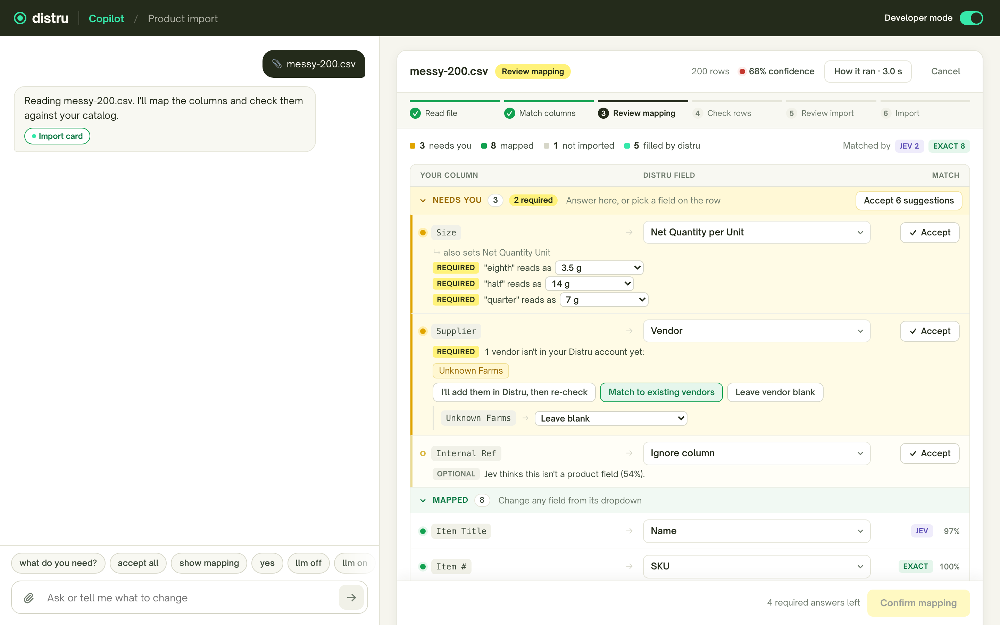

# Distru CSV Importer

Drop any product CSV or XLSX into the Distru Copilot chat and it becomes Distru products. The AI maps the columns,
asks only what it can't decide, and nothing is written until the user confirms twice: once for the mapping, once
for the import.



## Deliverables

| | |
|---|---|
| **1. UX mockup** | The demo below is the working mockup. Screenshots: [mapping](docs/screenshots/1-gate1-mapping.png), [import review](docs/screenshots/2-gate2-review.png), [finished](docs/screenshots/3-finished.png), [customer view](docs/screenshots/4-customer-view.png) |
| **2. System design** | [docs/system-design.md](docs/system-design.md): the agent harness, for chat now and workflows later |
| **3. Tech spec** | [docs/tech-spec.md](docs/tech-spec.md): the importer, ready for a coding agent |
| **4. Loom** | `<LOOM_LINK>` |

## Run it

Needs Docker.

```bash
docker compose up --build
```

Open http://localhost:5173. Jev and the LLM run as deterministic stubs by default. To use real models:

```bash
USE_REAL_MODELS=1 OPENAI_API_KEY=sk-... TYPESAFE_API_KEY=... docker compose up --build
```

Without Docker for the app (Node 22.22+, Docker still runs Postgres): `npm install && npm run demo`. Both ways use
port 5173, so stop one before starting the other.

## Try it

1. Drop [`fixtures/messy-200.csv`](fixtures/messy-200.csv) on the chat.
2. **Gate 1:** answer the questions in the card ("Read eighth as 3.5 g?", an unknown vendor), or type "accept all". Then "yes".
3. **Gate 2:** review new / skipped / invalid rows. Then "yes".
4. The right pane shows exactly what was sent to Distru's `POST /upload-products`, plus the error CSV.

Switch **Developer mode** off (top right) to see what a customer sees. More chat commands, other fixtures and model
setup: [docs/demo-guide.md](docs/demo-guide.md).

## Use the library

Copy [`csv-importer/`](csv-importer) into your repo as a workspace package. It is TypeScript source with no build
step, so the host needs a TS-aware bundler or runtime (Vite, tsx, Next.js `transpilePackages`), plus `@types/pg` and
`@types/papaparse` for type checking. One package, a subpath per module:

| Import | What it is |
|---|---|
| `@distru/csv-importer/core` | `ImportService` (state machine, both gates), parser, column profiles, units, transforms, validation, duplicates, template output |
| `@distru/csv-importer/scorers` | Column matchers (template, memory, exact, pattern, fuzzy, Jev, LLM) and the model gateway |
| `@distru/csv-importer/pg` | Postgres store (Kysely, row-level security); migrations in `csv-importer/migrations/` |
| `@distru/csv-importer/workers` | `createImporter` and the pg-boss jobs: parse, match, prepare, commit, follow-up, snapshot |
| `@distru/csv-importer/langgraph` | The six `import_csv_*` agent tools and `awaitGate` |
| `@distru/csv-importer/distru` | Distru product schema, upload/MCP profile, `MockDistru` |
| `@distru/csv-importer/ui` | React `ImportCard` and its parts (+ `ui/styles.css`) |

How a host app wires it up: [docs/api-integration.md](docs/api-integration.md).

## Tests and eval

```bash
npm install
npm test            # 139 tests; integration tests start Postgres with testcontainers
npm run eval        # column-matching precision/recall per fixture and per stage, latency vs targets
npm run typecheck
```

## What's built and what isn't

**Built:** the library above, the demo (chat + import card + mock Distru), 139 tests, the matching eval, and 7
fixtures.

**Not built:** the LangGraph agent loop (the demo agent is rule-based but calls the real six tools), the workflow path
(nightly Google Sheet sync; designed in the system design doc), retention cron and usage metering, auth in the demo,
streaming parse for very large files, Playwright E2E.

**Next:** confirm header spellings against the real Distru template; add `find-products-by-skus` and a batch update
tool to the Distru MCP; a Postgres-backed rate limiter for follow-ups; run the eval on real models and tune
thresholds.

Calls I made where the spec was silent, and known limits: [docs/decisions.md](docs/decisions.md).
