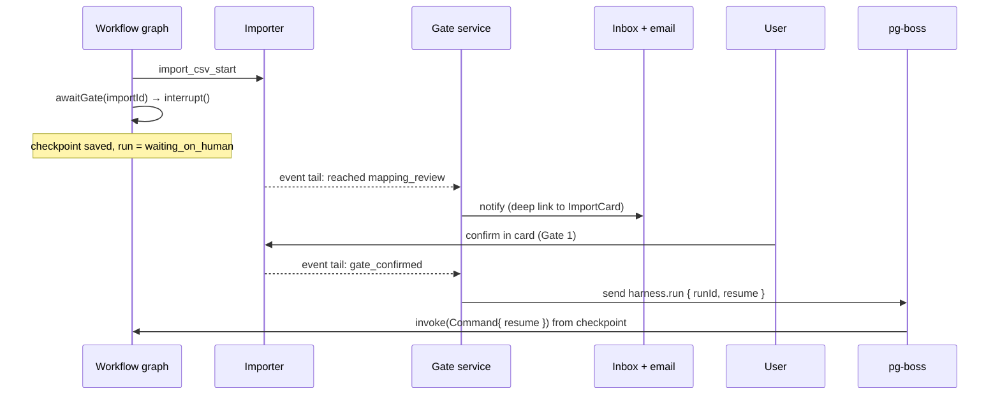
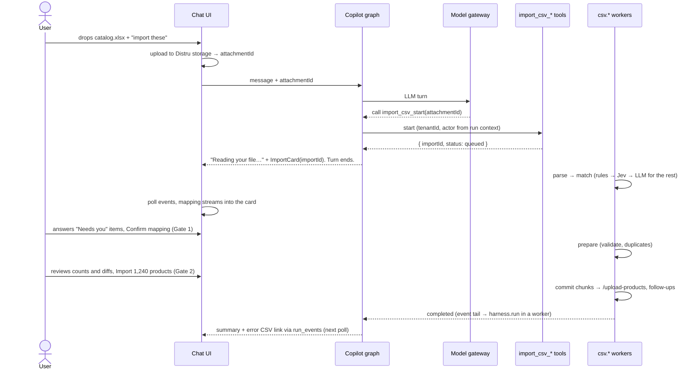
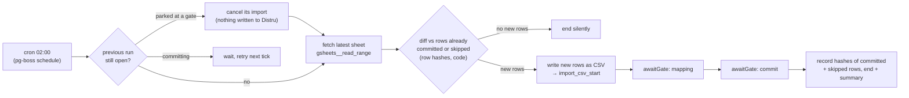

# Distru Agent Harness — System Design

## The thesis: boring agents

The harness exists to make agentic work **predictable, durable and safe to operate**. Four rules shape
every decision below:

1. **The LLM handles only the fuzzy part.** It interprets: what a column means when deterministic code
   and Jev couldn't tell, or what the user is asking for in chat. It returns a plan or a tool call. Code
   does everything else: parsing, validation, chunking, writing, retries, pausing and resuming.
2. **Every step is durable in Postgres.** Any process can crash at any point, and the work resumes from
   the last checkpoint. A browser reload loses nothing. Every write checks before it writes, so a retry
   never creates a duplicate.
3. **Writes pass a human gate.** The model can propose a write. Only a person can approve it: per call
   in chat, per run for *bulk* writes, or once when they enable a workflow for its *small* declared writes
   (§3 defines both).
4. **One toolset, two front doors.** The same tools, gates and state power the Copilot chat today and
   scheduled workflows tomorrow. What changes is who starts the run and how a gate is answered.

The CSV importer ([tech-spec.md](tech-spec.md)) is the first feature built on these rules. §9 shows the
next ones reuse the same pieces.

## 1. Architecture

**Decisions**
- **The harness is a separate Node service** that sits next to the Distru API and shares its Postgres
  cluster. It uses its own schemas and its own connection pool. That gives LangGraph.js its native
  ecosystem, lets the harness deploy and scale on its own, and keeps a model outage from taking down the
  ERP. Sharing Postgres means no new datastore, and lets the importer join against its catalog
  snapshot. Separate schemas make a later move to its own cluster possible; any cross-schema joins
  would have to be rewritten as API calls at that point.
- **One image, two roles.** The roles scale separately, so imports never slow chat replies.
  - `ROLE=api` serves the Run API and runs **user-started** Copilot turns in the request, because they
    stream.
  - `ROLE=worker` runs pg-boss jobs on separate queues: graph runs (`harness.run`) and import work
    (`csv.*`).
  - A **system-started** Copilot turn, such as the summary when an import finishes, runs as a
    `harness.run` job in a worker. It doesn't stream: its message lands in `run_events`, and the chat
    picks it up on its next poll.
- **Distru's API owns auth.** It forwards each request with a signed run context
  `{ tenantId, actor, actorToken, threadId }`. The harness trusts nothing else.
- **The actor token is a secret and is never persisted.** It lives only in an in-memory credential
  cache keyed by `runId`, and the MCP client reads it from there. It is never in:
  - `config.configurable`, because LangGraph can copy configurable keys into checkpoint metadata;
  - any table: checkpoints, `runs`, `run_events`, `tool_calls`, pg-boss job payloads;
  - a prompt, a tool result, a log line or a trace attribute.

  Anything without a live request asks Distru's API for a fresh short-lived token, using the harness
  service credential: a `harness.run` job mints one for the run's owner (the workflow's owner, or the
  thread's user for a system-started Copilot turn), and an
  importer job that calls Distru (snapshot, upload, follow-ups) mints one for the import's
  `created_by`. A cache miss after a restart just mints again. If the owner has been deactivated or lost
  the permission, minting fails, the run fails with that reason, and the tenant's admins are notified.
- **UI updates:** tokens for the reply in progress stream over SSE. Everything else is durable and read
  by cursor (`run_events` and `import_events`, `afterId`): the UI polls every 1 s while work is active and
  backs off when idle. A reload just re-reads from the cursor.

## 2. One runtime, two modes

Both modes are LangGraph graphs on the same runtime. They share the same tool registry, the same gate
service, the same checkpointer and the same audit log.

| | **Copilot** | **Workflow** |
|---|---|---|
| Started by | A user message | Cron, user action or webhook. *Watch* triggers (new email, new file) are a pg-boss cron, every 5 min, that polls the connection's MCP from a saved cursor such as the Gmail history id. Push webhooks replace polling later. |
| Graph | One tool-calling agent loop | A **typed template** + parameters, e.g. `sheet_to_products({ connectionId, sheetId, schedule })` |
| Who picks the next step | The LLM, from the tenant's tools | The template's edges. The LLM runs only inside declared nodes and returns structured output, with no tools. |
| Tools | Every tool the tenant and actor can use | The template's allowlist only |
| Who answers a gate | The user, by card button or a "yes" in chat | The user, after a notification (inbox + email) with a deep link to the same card |
| Waiting at a gate | The agent's turn ends. The card shows the live state. | The run parks (`interrupt()`). Its status is `waiting_on_human`. |
| Gate timeout | Parked until `retention.abandonedDays` (7), then cancelled. No reminder: the user started it on screen, and open imports are pinned at the top of Copilot until they're finished or cancelled. | Same 7 days, with a reminder after 24 h. A recurring workflow usually replaces the parked run sooner (see Overlap). |
| Overlap | One turn per thread at a time. A message sent mid-turn is queued. | One active run per workflow. A new trigger **replaces** a parked run, so the user always reviews the latest data (§5b). |

**Why typed templates rather than free-form agent plans.** A workflow runs unattended at 2 a.m. It has to
do the same thing every night, be testable with fixtures, and show the user exactly which writes it can
make before they turn it on. A template is a graph that Distru engineers write and test, plus parameters
the user fills in. Copilot stays free-form, because a person is watching every turn. When copilot users
keep asking for the same thing, that request becomes a template.

## 3. Tool model

| Kind | Example | Runs | Credentials |
|---|---|---|---|
| First-party | `import_csv_start` | In-process TypeScript, Zod-typed | None of its own. Uses the run context. |
| Distru MCP | `distru__search-products` | MCP client per run | **The actor's own Distru token**, so the agent can never do more than the user could in the UI |
| Customer MCP | `gsheets__read_range` | MCP client per run | The tenant's connection (OAuth), encrypted at rest, decrypted only inside the client |

- **Naming:** `<source>__<tool>` for MCP tools, and plain `<feature>_<verb>` for first-party tools. This
  avoids collisions when two servers both expose `search`.
- **Per-run registry:** built at run start from the first-party tools enabled for the tenant, plus the
  Distru MCP, plus the tenant's active connections. It is then filtered by mode (the template allowlist)
  and by the actor's permissions, which are checked on every run and never cached.
- **Tool list cache:** `list_tools` results are cached per connection for up to 1 h. The cache is
  dropped when the connection is revoked or reconnected, when its scopes change, or on any
  unknown-tool or `list_tools` error.
- **Every tool carries an effect tag:** `read`, `write` or `gated`. An MCP tool is a `write` unless
  Distru's curated tag list for that server says `read`. A server's own `readOnlyHint` is untrusted
  input and isn't enough.
  - `read`: runs freely.
  - `write`: in Copilot, the call shows an approval card with the full arguments first, so the user sees
    exactly what is written and where. Writes the model asks for in the same step share one card, with
    a checkbox per call, and nothing runs until the card is answered. In a workflow, the write must be
    listed in the template.
  - `gated`: the tool owns its gates. The importer's two gates are required on every run, in both modes.
- **Bulk vs small, for workflows.** A workflow write is **bulk** if any of these is true:
  - it touches more than one record per call;
  - it can't be undone by one follow-up write (deletes, sends that leave the tenant: email, Metrc);
  - it changes compliance or sale status (for example *mark ready for sale*).

  Bulk writes get a gate on **every run**. Everything else is **small**: one record, reversible, such as
  attaching a file or setting a note. The user approves a template's small writes **once**, when they
  enable the workflow. The template author tags each write, and the registry rejects a write tagged
  small whose tool is on Distru's bulk list.
- **Run context is injected, never generated.** `tenantId` and `actor` come from LangGraph
  `config.configurable`, and tokens come from the in-memory credential cache (§1). No tool schema has a
  tenant argument the model could fill in.
- **Check before every write.** Every write looks up its natural key first. This holds in every mode,
  not only after a crash.
  - A **create** is skipped if the key already exists.
  - An **update** compares current values with the target values. It writes only the fields that
    differ, and is skipped only when nothing differs.
  - First-party tools implement this themselves. The importer re-checks SKUs against Distru before each
    commit chunk.
  - Customer MCP writes in a workflow template are preceded by a lookup node.
  - MCP writes in Copilot are checked by a harness wrapper, not by the agent.
    - Distru's curated tag list maps each write tool to its read tool and key. The wrapper runs that
      lookup and shows current vs new values on the approval card.
    - A write tool with no lookup mapping shows *"Can't check for duplicates"* on the card, and is
      blocked in workflows.
  - All writes also go through the `tool_calls` ledger with the idempotency key `runId:toolCallId`. A
    replayed call that already succeeded returns the recorded result instead of calling again.
- **Result size:** what enters a model's context is capped at 4k tokens per tool result. Larger results
  are stored in `tool_results` and replaced with a summary plus a handle the agent can page through.
  Code nodes in a workflow read full results directly; the cap only protects the model. Importer tools
  return under 1k tokens and never return rows.

## 4. Durable execution and human in the loop

There are three durable layers, each doing one job.

| Layer | Owns | Never does |
|---|---|---|
| **LangGraph `PostgresSaver`** (same database, `langgraph` schema) | Where a conversation or workflow is: messages, the current node, open interrupts | Long or heavy work. A graph step finishes in seconds. |
| **pg-boss** | Heavy, retryable work (`csv.*`), cron schedules, and `harness.run` jobs | Conversation state |
| **Domain tables** (`csv_import.imports`…) | **The truth about the business object**, including which gate it waits on | |

**One job type drives every background graph run:** `harness.run { tenantId, runId, resume? }`.
- It loads the run's checkpoint and executes the graph until the graph interrupts, finishes, or ends a
  turn.
- A trigger enqueues it with no `resume`. A gate confirmation or a finished import enqueues it with
  `resume: { gateId, outcome }` or `resume: { event }`.
- `singletonKey = runId`, so a run never executes twice at once.
- The payload holds ids only: never tokens, never content.

Rule: **graph nodes enqueue, then wait.** A node that needs minutes of work starts a job and either ends
the turn (Copilot) or interrupts (workflow). The import's own status is the source of truth. A LangGraph
interrupt is only how a workflow run waits for it.

**How the harness learns a gate moved.** The importer is a library with an append-only `import_events`
log, and the harness doesn't change it. The gate service tails that log with one cursor: a pg-boss job
reads new events by `id` every 2 s. It maps `importId` to a run through the `gates` table, and on:
- *reached a gate*, it notifies (workflows);
- *gate confirmed* or *import finished*, it enqueues `harness.run` with `resume`.

The tail is the one job that reads across tenants, so it is held to two rules:
- It reads only `(event id, type, import id)`, plus `tenant_id` joined from `imports`, never payloads.
- It handles each event inside `withTenant(event's tenantId)` (§7). The run lookup, the notification
  (addressed to that tenant's users) and the job it enqueues are therefore all tenant-scoped, and
  nothing from one tenant reaches another.

Polling one indexed log is boring and survives restarts. `LISTEN/NOTIFY` can lower the latency later
behind the same interface.

- **Copilot resume:** nothing is suspended. The card reads the import by `importId`.
  - When the user confirms in the card, the gate service appends a `gate_confirmed` event to the thread,
    so the agent's next turn knows.
  - A "yes" in chat goes through `import_csv_confirm_*`, which records the confirming message id.
  - When the import finishes, `harness.run` runs one system-started agent turn in a worker. Its summary
    reaches the chat through `run_events` (§1).
- **Crash during a background run:** the `harness.run` job expires and is retried. LangGraph replays
  from the last checkpoint. A replayed write is caught by the check-before-write rule and the
  `tool_calls` ledger (§3). The importer also dedupes re-uploads by file hash.
- **Crash during a Copilot turn:** the checkpoint up to the last finished node survives. The chat shows
  *"Reply interrupted · Retry"*, and retrying resumes from that checkpoint with a fresh request (and a
  fresh token). Imports already started keep running in workers either way.
- **Crash during an import job (`csv.*`):** handled by the importer's chunk checkpoints (tech spec §5).

## 5. CSV import walkthrough

### 5a. Copilot

The agent is in the loop only twice: once to start the import, and again to explain the result or apply
a chat edit ("the Size column is in ounces") through `import_csv_revise`. Everything in between is code
and a card.

### 5b. Workflow: "Every night, create new products from this Google Sheet"

- **There's no LLM in the control flow.** Column memory resolves the same headers at stage 1 every
  night, so matching is deterministic.
  - The LLM is called only for a header that misses column memory and stages 2–5 of the cascade (tech
    spec §4.1).
  - The run also stores a hash of the header row. When it changes, the notification says *"Columns
    changed since the last run"*, so the user knows to look closely at Gate 1.
- **The diff is code.** `harness.workflow_rows (tenant_id, workflow_id, content_hash, status, import_id,
  updated_at)` holds a hash of every row that was committed or that the user chose to skip at Gate 2.
  - Each run imports only rows whose hash isn't in that table, meaning rows that are new or changed. A
    night with no new rows sends no notification.
  - The rows are kept for as long as the workflow exists, and deleted with it.
  - The importer still checks Distru for duplicates (tech spec §6), so a product someone added by hand
    isn't created twice.
  - The new rows are written as a CSV to Distru storage and passed to `import_csv_start` like any
    upload, so the importer can't tell a workflow file from a chat file.
  - Rows that failed at commit aren't recorded, so they come back the next night until they're fixed in
    the sheet.
- **No row is ever lost, and the user always reviews the latest sheet.** If last night's run is still
  parked at a gate, tonight's run cancels that import (nothing was written to Distru yet). It then fetches the
  latest sheet and diffs it against what was actually committed. The new import therefore contains every
  row from the parked run plus everything added since.
  - Mapping answers the user already confirmed at Gate 1 are kept in column memory and reused. Row edits
    made in the replaced card aren't carried over; the sheet is the source to fix.
  - The old card says *"Replaced by a newer run"* and links to the new one, which carries the only open
    notification.
  - A run that is already committing can't be cancelled. The tick waits, and the next one picks up
    whatever wasn't committed.
- **One notification, one sitting.** The email opens the card at Gate 1. With an unchanged mapping that
  takes one click, and Gate 2 follows a few seconds later in the same card. Both gates stay required.

## 6. Model strategy

| Decision | Model | Why |
|---|---|---|
| A bounded choice: which field a column is, which value a cell maps to, which inventory a document belongs to, which workflow to route to | **Jev** | Picks from a closed set of options, returns a probability per option, runs in under 1 s and costs little. Its scores feed the gates. |
| Open-ended work: residual mappings, transforms the DSL can't infer, extracting fields from a PDF, the chat itself | **BYO LLM** (LangChain `BaseChatModel`) | Needs language understanding. Always called with schema-constrained output where code acts on the result. |
| Everything else | **Code** | Free, instant, testable. |

- Every model call goes through the **model gateway**. It handles the timeout and one retry. When a model
  fails, the item degrades to "needs you"; it never dead-ends.
- **Usage is metered from day one; pricing comes later.** Every model call and tool call writes a
  `usage_events` row with:
  - tenant, actor, run, mode and feature (for example `csv_import`);
  - model, input and output tokens, Jev calls, latency;
  - MCP calls per connection.

  The rows hold no content. Billing, budgets or limits can be built on this table later without
  re-instrumenting anything.
- **BYO:** Distru picks the provider per deployment. The core uses only the `BaseChatModel` interface, no
  provider-specific features, so changing models is a config change followed by an eval run.
- **Cost shape:** most of an import never touches the LLM (target: under 20% of columns, tech spec
  §4.1). The LLM sees headers, samples and distinct values, never all rows. So a 10k-row import costs
  about the same in model spend as a 100-row one.

## 7. Safety

- **Tenant isolation.** The run context comes from Distru's auth, never from the model.
  - Every `harness` and `csv_import` table has `tenant_id`. Postgres row-level security is enforced with
    `app.tenant_id`, as defense in depth on top of scoped queries.
  - **One path for API and workers.** All database access goes through `withTenant(tenantId, fn)`,
    which opens a transaction and runs `SET LOCAL app.tenant_id` first.
    - The API takes `tenantId` from the signed run context.
    - A worker takes it from the job payload. Every `csv.*` and `harness.run` payload carries
      `tenantId`, and the worker re-checks it against the row it loads.
  - Only system jobs (the event tail, the retention cron) use a separate `harness_system` role that can
    read across tenants. They read ids only and switch into `withTenant` for any work.
  - LangGraph checkpoints and pg-boss tables have no `tenant_id`. They are only reached through a
    `runId` or `threadId` taken from `runs`, which does.
  - MCP credentials are per tenant, and Distru MCP calls use the actor's own token.
- **Retention.** Checkpoints (they hold chat messages) and `tool_results` follow the importer's
  `retention.rowsDays` (90), enforced by the same cleanup cron.
- **Prompt injection.** File cells, emails, PDFs and tool output are data. They're wrapped as untrusted
  content in prompts.
  - In workflows, LLM nodes have **no tools**. They return structured output that code validates. An
    injected instruction in an email can at worst produce a wrong value, which the gate shows.
  - In Copilot, tool output can't add tools or widen the allowlist, and every write needs approval
    whatever the model says. The approval card shows the full arguments, so an injected "send this data
    to X" is visible before anything leaves.
- **Webhook triggers** verify a per-workflow signing secret before a run starts.
- **Confirmation.** Writes follow the effect tags and the bulk/small rule (§3). In Copilot every write
  is approved. In workflows, bulk writes are gated on every run, and small writes are approved once at
  enable time.
- **Audit.** `tool_calls` is append-only. Each row records the run, actor, tool, redacted arguments,
  result summary, latency, and the gate or confirming message that allowed it. Redaction keeps what
  explains the write and drops the rest:
  - **Secrets are removed:** tokens, API keys, auth headers, connection credentials → `"[secret]"`.
  - **Files become a reference:** bytes → `{ attachmentId, sha256, sizeBytes }`.
  - **Long free text becomes a fingerprint:** any string over 256 characters, such as an email body or a
    description → `{ sha256, length }`.
  - **Contact details are masked:** email addresses and phone numbers → `j***@acme.com`, `***-***-1234`.
  - **Kept as-is:** ids (product, package, import), field names, enum values and short business values
    (`{ productId: "p_81", set: { unitPrice: 25 } }`), so support can tell what changed.
- **Secrets.** Actor tokens and connection credentials never enter prompts, tables (other than encrypted
  connections), traces or logs (§1, §8).

## 8. Observability

- **Traces:** one OpenTelemetry trace per run, with spans for each graph node, tool call and model call
  (exported through LangChain callbacks). They go to Distru's existing tracing backend.
- **Traces carry no customer data.** The exporter keeps span attributes on an **allowlist**, not a
  blocklist, so a new field is dropped until someone allows it.
  - **Allowed:** ids, statuses, counts, durations, token counts, model and tool names, error codes, and
    hashes of inputs.
  - **Never exported:** file bytes, cell values, column samples, prompts, completions, tool arguments or
    results, chat messages, tokens.

  Debugging a specific run uses the tenant-scoped Postgres records (`import_events`, `tool_calls`), behind
  Distru's normal support access controls. LangSmith is for development only, with fixture data.
- **Events:** `run_events` has the same shape as `import_events`. It powers the UI, the inbox and support
  ("what happened to my nightly import?").
- **Metrics:**
  - runs by mode and outcome (completed, parked, failed);
  - gate wait time;
  - time to first mapping;
  - share of columns resolved per cascade stage;
  - LLM tokens and cost per tenant and feature (from `usage_events`);
  - error rate per MCP connection;
  - follow-up throughput.
- **Evals:** the importer's matching eval is the template for every feature. It has fixtures with
  expected outputs, precision and recall, the share resolved per stage, and latency against targets. It
  runs in CI on every prompt, model or threshold change. Corrections users make at Gate 1 are labeled
  data. They flow back into the fixture set only from tenants who opt in, as headers plus anonymized
  samples.

## 9. Extending it

| Next feature | New code | Reused as-is |
|---|---|---|
| **Lab result PDF → inventory** (the brief's example) | Workflow template: watch email → Jev "is this a COA?" → LLM extracts lab, batch and potency → code matches the Distru package → gate "attach and mark ready for sale" | Triggers, gates, model gateway, audit, eval template |
| Vendor / customer import | An importer profile: schema file + sink | The whole importer, the tools, the card |
| Price list or inventory count update | A profile with an update-only sink | Importer, duplicate snapshot, Gate 2 diff |
| QuickBooks item sync | Workflow template: QB MCP read → importer-style diff → gate | Connections, registry, gates |
| "What's low on stock?" | Nothing. Read-only Distru MCP tools in Copilot. | Registry, run context |
| PO from a vendor email | Workflow template: LLM extraction → Jev SKU matching → gate | Same as the lab results template |

A new feature adds a profile, a template or a first-party tool. It never adds a new runtime, queue or
gate mechanism.

## 10. MVP cut

| MVP (ships with the importer) | Next | Later |
|---|---|---|
| Copilot graph, `PostgresSaver`, pg-boss | Workflow templates + scheduler, starting with `sheet_to_products` | A template builder UI |
| Tool registry: first-party + Distru MCP | Customer MCP connections (OAuth): Sheets, Gmail | Tool search for tenants with many tools |
| Gates, effect tags, `tool_calls` audit, RLS | Inbox + email notifications, shipped with workflows (MVP is Copilot only, where the card is the notification) | Per-tool rate limits per connection |
| Model gateway: Jev + one LLM, `usage_events` metering | Usage dashboards per tenant | Billing or limits built on `usage_events` |
| `run_events` polling, redacted OTel traces, importer eval in CI | SSE for events (replacing polling) | Online evals from production corrections |
| Short-lived token minting, credential cache | Batch MCP tools (`find-products-by-skus`, batch update) | Per-tenant fair share on worker queues |
