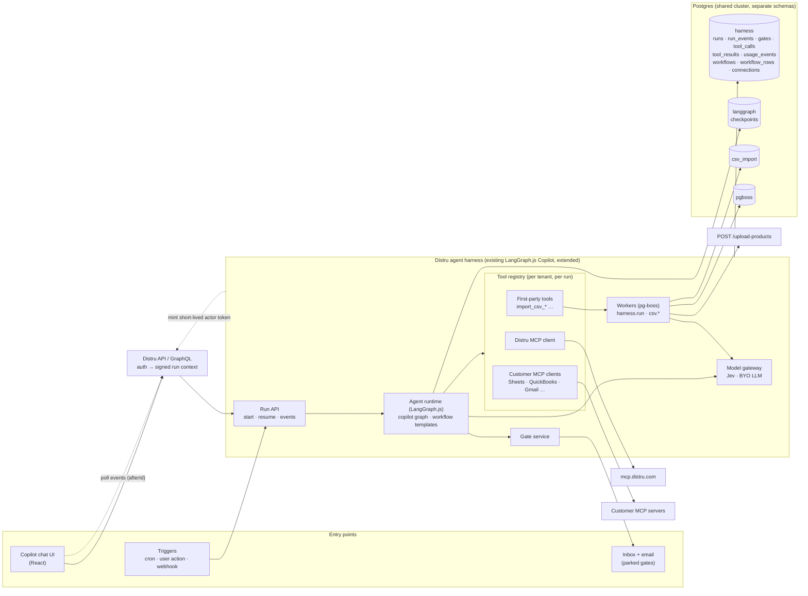
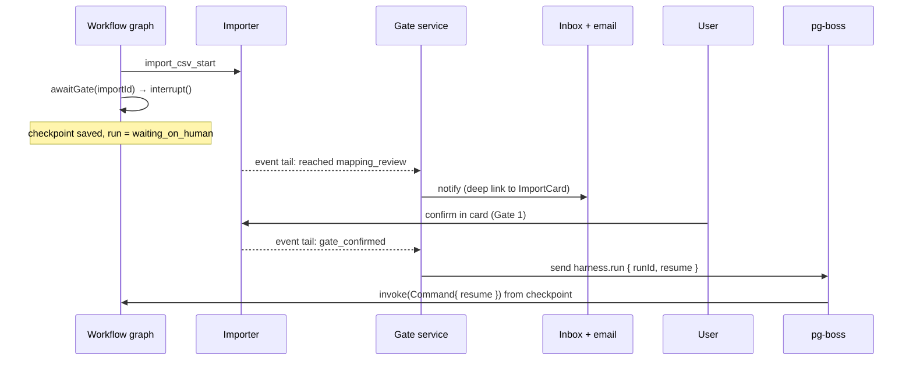
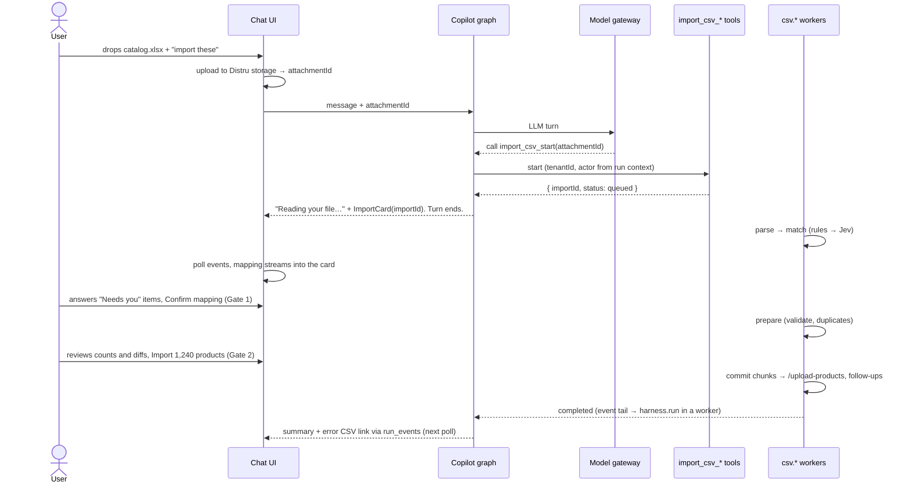
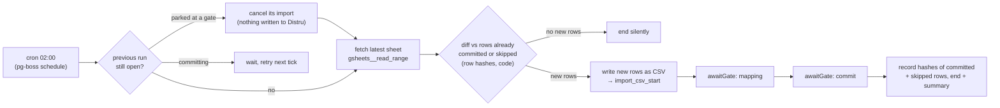

# Distru Agent Harness — System Design

## Thesis: boring agents

The harness makes agentic work **predictable, durable and safe to operate**. Four rules drive every decision:

1. **The LLM handles only the fuzzy part.** It interprets (what a column means, what the user asked) and returns
   a plan or a tool call. Code does everything else: parsing, validation, writes, retries, pause and resume.
2. **Every step is durable in Postgres.** A crash or a browser reload loses nothing. Every write checks before it
   writes, so a retry never duplicates.
3. **Writes pass a human gate.** The model proposes; only a person approves.
4. **One toolset, two front doors.** The same tools, gates and state power the Copilot chat today and scheduled
   workflows tomorrow.

This design **extends Distru's existing LangGraph.js Copilot**; it doesn't add a service. The CSV importer
([tech-spec.md](tech-spec.md)) is the first feature on these rules: a library that plugs in as six `import_csv_*`
tools plus pg-boss jobs. §9 shows the next ones reuse the same pieces. Rationale and rejected alternatives:
[decisions.md](decisions.md).

## 1. Architecture

- **Built into Distru's existing LangGraph.js Copilot, not a new service.** The importer is a library: its six
  `import_csv_*` tools join the Copilot's tool registry, and its jobs run on pg-boss. What this design adds to the
  harness: the gate service, effect tags on tools, the `harness` tables and workflow templates. Everything lives
  in Distru's Postgres under its own schemas, so there's no new datastore.
- **Chat turns and heavy work run in different processes.** API processes serve the Run API and stream
  user-started Copilot turns. Worker processes (`ROLE=worker`) run pg-boss jobs: graph runs (`harness.run`) and
  import work (`csv.*`). A tool call starts a job and returns at once, so imports never slow chat.
- **Distru's API owns auth.** It forwards a signed run context `{ tenantId, actor, actorToken, threadId }`. The
  actor token lives only in memory, keyed by `runId`. Background work mints a fresh short-lived token for the
  run's owner.
- **UI updates:** the reply in progress streams over SSE. Everything else is a durable event log
  (`run_events`, `import_events`) read by cursor. A reload re-reads from the cursor.

## 2. One runtime, two modes

| | **Copilot** | **Workflow** |
|---|---|---|
| Started by | A user message | Cron, user action, webhook. *Watch* triggers (new email, new file) poll the connection every 5 min from a saved cursor. |
| Graph | One tool-calling agent loop | A **typed template** + parameters, e.g. `sheet_to_products({ connectionId, sheetId, schedule })` |
| Next step chosen by | The LLM | The template's edges. LLM nodes return structured output and have no tools. |
| Tools | Everything the tenant and actor can use | The template's allowlist |
| Gate answered by | The user, card button or "yes" in chat | The user, from an inbox + email notification linking to the same card |
| Waiting at a gate | The turn ends; the card shows live state | The run parks (`interrupt()`), status `waiting_on_human` |
| Gate timeout | Cancelled after 7 days. No reminder: the user started it on screen, and open imports stay pinned at the top of Copilot. | Same 7 days, with a reminder after 24 h |
| Overlap | One turn per thread; later messages queue | One active run per workflow; a new trigger **replaces** a parked run (§5b) |

**Why typed templates, not free-form agent plans.** A workflow runs unattended at 2 a.m. It must do the same
thing every night, be testable with fixtures, and show the user exactly which writes it can make before they
enable it. Copilot stays free-form because a person watches every turn. A request copilot users keep repeating
becomes a template.

## 3. Tool model

| Kind | Example | Runs | Credentials |
|---|---|---|---|
| First-party | `import_csv_start` | In-process TypeScript, Zod-typed | Run context only |
| Distru MCP | `distru__search-products` | MCP client per run | **The actor's own token**: the agent can't do more than the user could |
| Customer MCP | `gsheets__read_range` | MCP client per run | The tenant's OAuth connection, encrypted at rest |

- **Per-run registry**, built from the tenant's enabled first-party tools, the Distru MCP and active connections,
  then filtered by mode and the actor's permissions. Names are `<source>__<tool>` to avoid collisions.
- **Run context is injected, never generated.** No tool schema has a tenant argument the model could fill in.
- **Effect tags** on every tool: `read` runs freely; `write` needs approval; `gated` owns its gates (the
  importer). An MCP tool is a `write` unless Distru's curated list says otherwise.
  - **Copilot:** every write shows an approval card with its full arguments, and current vs new values. A harness
    wrapper (not the agent) runs the lookup that Distru's curated list maps to each write tool. A write with no
    mapping shows *"Can't check for duplicates"* on the card, and is blocked in workflows.
  - **Workflow:** a **bulk** write (many records, irreversible, or compliance/sale status) is gated on every
    run. A **small** write (one record, reversible) is approved once when the workflow is enabled.
- **Check before every write.** A create is skipped if its natural key exists. An update writes only the
  fields that differ. All writes go through a `tool_calls` ledger keyed `runId:toolCallId`, so a replay returns
  the recorded result.
- **Result size:** at most 4k tokens of a tool result enter the model's context. Larger results are stored and
  replaced by a summary plus a handle to page through. Importer tools return < 1k tokens and never rows.

## 4. Durable execution and human in the loop

| Layer | Owns | Never does |
|---|---|---|
| **LangGraph `PostgresSaver`** | Where a conversation or workflow is: messages, current node, open interrupts | Long work. A graph step takes seconds. |
| **pg-boss** | Heavy retryable work (`csv.*`), cron schedules, `harness.run` | Conversation state |
| **Domain tables** (`csv_import.imports`…) | The truth about the business object, including which gate it waits on | |

- **One job type drives every background graph run:** `harness.run { tenantId, runId, resume? }`.
  `singletonKey = runId`, so a run never executes twice at once. Payloads hold ids only.
- **Graph nodes enqueue, then wait.** A node that needs minutes of work starts a job, then ends the turn
  (Copilot) or interrupts (workflow). The import's status is the truth; an interrupt is only how a run waits.
- **The gate service tails `import_events`** every 2 s and maps each import to its run. *Reached a gate* →
  notify. *Gate confirmed* or *finished* → enqueue `harness.run` with `resume`. Polling one indexed log is
  boring and survives restarts; `LISTEN/NOTIFY` can replace it behind the same interface.

**Crashes**
- *Background run:* the job expires and retries; LangGraph replays from the last checkpoint; the write ledger
  and check-before-write stop duplicates.
- *Copilot turn:* the chat shows *"Reply interrupted · Retry"*, which resumes from the checkpoint. Imports keep
  running in workers either way.
- *Import job:* chunk checkpoints in the importer (tech spec §5).

## 5. CSV import walkthrough

### 5a. Copilot

The agent is in the loop only to start the import, apply chat edits ("the Size column is in ounces") and explain
the result. Everything in between is code and a card.

### 5b. Workflow: "Every night, create new products from this Google Sheet"

- **No LLM in the control flow.** Column memory resolves the same headers every night; Jev scores a header it
  hasn't seen.
- **The diff is code.** `harness.workflow_rows` stores a hash of every row committed or skipped. Only new or changed
  rows are imported; a quiet night sends nothing. Failed rows aren't recorded, so they retry until fixed.
- **The user always reviews the latest data.** A run still parked from last night is cancelled (nothing was
  written) and replaced by one built from the current sheet. A run already committing is never interrupted.
- **One notification, one sitting.** With an unchanged mapping Gate 1 is one click, and Gate 2 follows in the
  same card. Both gates stay required.

## 6. Model strategy

| Decision | Model | Why |
|---|---|---|
| A bounded choice: which field is this column, which vendor is this value, is this a COA? | **Jev** | Picks from a closed set with a probability per option, < 1 s, cheap. Scores feed the gates. |
| Open-ended work: free-text edits, PDF extraction, the chat | **BYO LLM** (LangChain `BaseChatModel`) | Needs language. Schema-constrained output wherever code acts on it. |
| Everything else | **Code** | Free, instant, testable |

- Every call goes through the **model gateway**: timeout, structured output, usage metering. A model failure
  degrades the item to "needs you"; it never dead-ends.
- **Usage metered from day one** in `usage_events` (tenant, run, feature, model, tokens, latency; no content).
  Pricing and limits come later without re-instrumenting.
- **BYO model** is a config change plus an eval run; the core uses only the `BaseChatModel` interface.
- **LLM column matching is off by default, because the eval says so.** With real Jev, turning it on
  (`gpt-4o-mini` or `gpt-4o`) dropped precision from 94.8% to 92.4% at the same recall: the LLM decided 1-2 columns per run and got none right, and it adds seconds. So the importer runs rules → Jev, and what Jev can't settle is asked at
  Gate 1. It's one switch to turn back on once a model beats Jev in the eval.
- **Cost shape:** models see headers, samples and distinct values, never all rows. A 10k-row import costs about
  the same as a 100-row one.

## 7. Safety

- **Tenant isolation.** The run context comes from Distru's auth, never the model. Every table has `tenant_id`
  with Postgres row-level security, entered through one `withTenant(tenantId, fn)` path for API and workers.
  Distru MCP calls use the actor's own token.
- **Prompt injection.** File cells, emails, PDFs and tool output are wrapped as untrusted data. Workflow LLM nodes
  have no tools, so an injected instruction can at worst produce a wrong value, which a gate shows. In Copilot,
  every write is approved with its full arguments visible.
- **Confirmation** follows the effect tags (§3).
- **Audit.** `tool_calls` is append-only: run, actor, tool, redacted arguments, result, and the gate or message
  that allowed it. Secrets removed, files by hash, long text fingerprinted, contacts masked.
- **Secrets** never enter prompts, tables, traces or logs.

## 8. Observability

- **Traces:** one OpenTelemetry trace per run (spans per node, tool call, model call) into Distru's tracing
  backend. Attributes pass an **allowlist** (ids, statuses, counts, durations, model names), so customer data
  never leaves. Debugging a run uses the tenant-scoped event tables.
- **Metrics:** runs by mode and outcome, gate wait time, time to first mapping, columns resolved per cascade
  stage, LLM cost per tenant and feature, MCP error rate per connection.
- **Evals:** the importer's matching eval (fixtures, precision/recall, share per stage, latency) is the template
  for every feature. It runs in CI on every prompt, model or threshold change. Gate 1 corrections become labeled
  data from tenants who opt in.

## 9. Extending it

| Next feature | New code | Reused as-is |
|---|---|---|
| **Lab result PDF → inventory** (the brief's example) | Template: watch email → Jev "is this a COA?" → LLM extracts lab, batch, potency → code matches the package → gate "attach and mark ready for sale" | Triggers, gates, model gateway, audit, eval |
| Vendor / customer import | An importer profile: schema file + sink | The whole importer, tools, card |
| Price list / inventory count update | A profile with an update-only sink | Importer, snapshot, Gate 2 diff |
| QuickBooks item sync | Template: QB MCP read → importer-style diff → gate | Connections, registry, gates |
| "What's low on stock?" | Nothing: read-only Distru MCP tools in Copilot | Registry, run context |
| PO from a vendor email | Template: LLM extraction → Jev SKU matching → gate | Same as lab results |

A new feature adds a profile, a template or a tool. Never a new runtime, queue or gate mechanism.

## 10. MVP cut

| MVP (ships with the importer) | Next | Later |
|---|---|---|
| Copilot graph, `PostgresSaver`, pg-boss | Workflow templates + scheduler, starting with `sheet_to_products` | Template builder UI |
| Tool registry: first-party + Distru MCP | Customer MCP connections (Sheets, Gmail) | Tool search for large toolsets |
| Gates, effect tags, `tool_calls` audit, RLS | Inbox + email notifications (ship with workflows) | Per-connection rate limits |
| Model gateway (Jev + one LLM), usage metering | Usage dashboards | Billing / limits on usage |
| Event polling, redacted traces, importer eval in CI | SSE for events | Online evals from production corrections |
| Token minting, credential cache | Batch MCP tools (`find-products-by-skus`, batch update) | Per-tenant fair share on queues |
