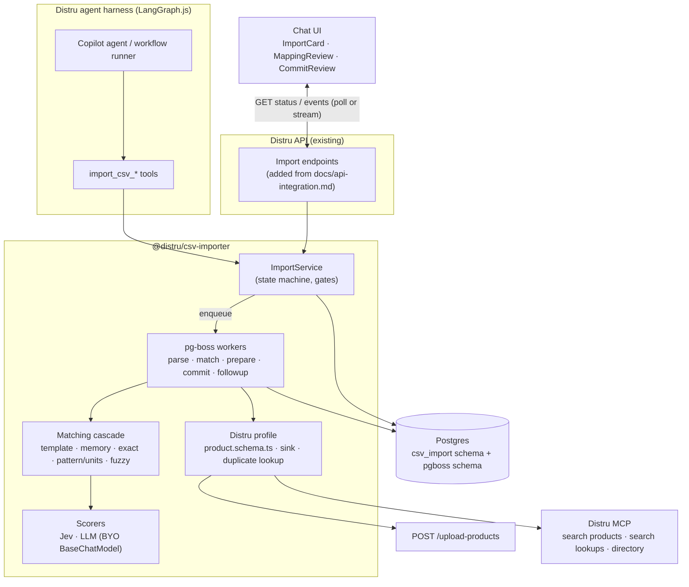
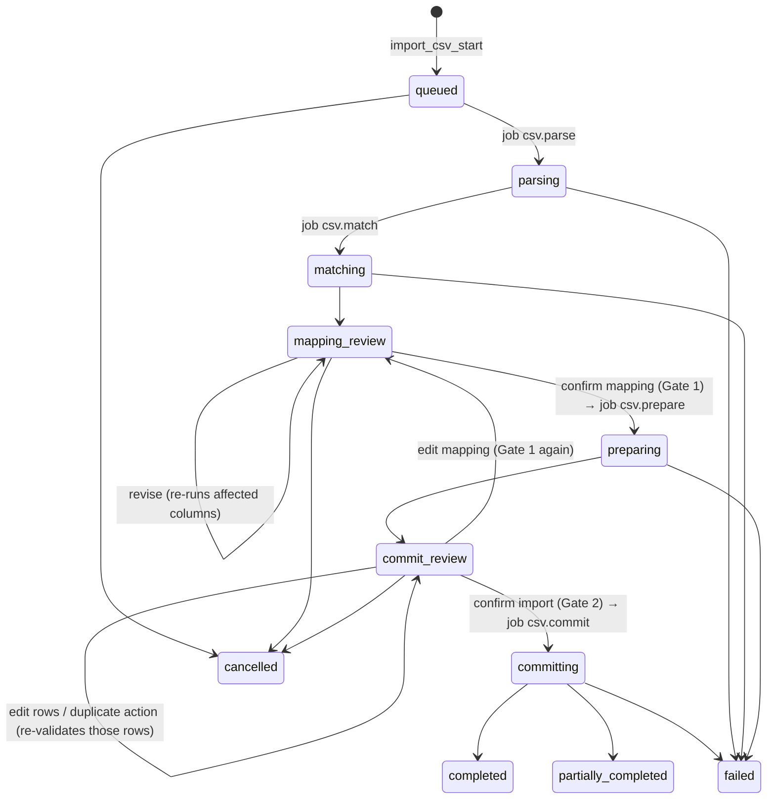
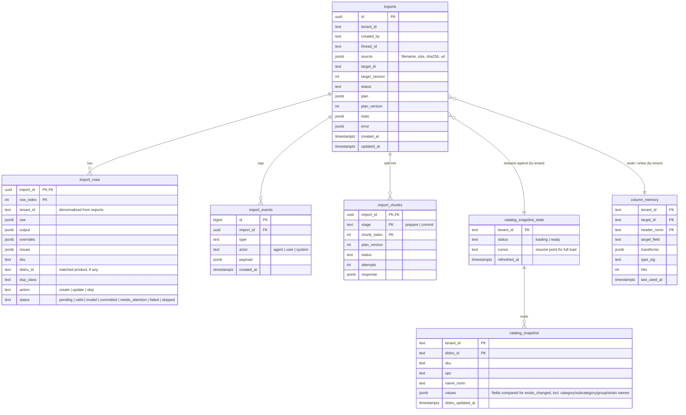

# CSV Importer — Tech Spec

## 1. Summary

A TypeScript library that turns any customer CSV/XLSX into rows that match a **target schema** you pass in,
then hands those rows to a **sink** (for Distru: `POST /upload-products`). It ships as LangGraph.js tools for
the Distru agent harness, so the Copilot chat and future workflows run the same code.

Principles:
- **Schema-agnostic.** The core knows nothing about products. Distru products is one profile: a schema
  file, a sink, a duplicate lookup and a reference resolver.
- **Deterministic first.** Exact names, synonyms, regex patterns, data types and a cannabis unit parser
  resolve most columns. Jev scores what is left. A full LLM call is the last resort.
- **The LLM decides, code executes.** Models see headers, profiles and samples only, and return a plan.
  Code applies the plan to every row.
- **Durable by default.** Every step is a pg-boss job writing to Postgres. Tool calls return immediately,
  and the UI resumes from the import id after a reload or a dropped connection.
- **Two required human gates.** Confirm the mapping, then confirm the import. The library never
  auto-approves. Confidence scores inform the person but never skip a gate.
- **Unopinionated I/O.** Distru owns the file upload and storage. The library takes bytes or a readable URL.

Out of scope: the harness, workflow triggers, the HTTP API (we ship SQL and an integration guide), file
storage, and entities other than products.

## 2. Architecture



### Build vs buy

| Concern | Choice |
|---|---|
| Background jobs, retries, resume | **pg-boss** (Postgres-native, no Redis) |
| CSV parsing | papaparse (streaming, delimiter sniffing) |
| XLSX | SheetJS (cdn.sheetjs.com build) |
| Encoding | jschardet + iconv-lite |
| Schema / validation | Zod v4 (stored as JSON Schema) |
| DB access / migrations | `pg` + kysely, plain SQL migration files |
| Fuzzy match | **talisman** (Jaro-Winkler, token-set metrics) |
| Field scoring | Jev (TypeSafe) behind a `Scorer` port |
| LLM | Bring your own LangChain `BaseChatModel` |
| UI | React + TanStack Table/Virtual + shadcn/ui |
| Tests | Vitest + testcontainers (Postgres) |

## 3. Target schema (drop-in file)

The Distru product schema lives in one file, `packages/distru/src/product.schema.ts`. Editing this file is
the only change needed when Distru's template changes.

**Where it comes from:**
- **H:** Distru's help article *Importing and updating products*, which describes the Settings → Import
  Data → Products template.
- **M:** the MCP `distru-mutate-product` tool, for types and enums.

The help article lists field labels, not literal CSV header spellings, and leaves out a few fields that
the MCP has (rows marked **M** only).
- `templateHeaders` contains **H fields only**, so the upload never sends a column the template might reject.
- **M**-only values are applied after upload through the follow-up update path (§5).
- **Field groups are atomic.** *weight* = net weight, serving size and unit; *potency* = THC, CBD and
  cannabinoid unit. If any field in a group is M-only, the **whole group** goes through follow-up, so a
  product never holds a weight without its unit.
- Before shipping, one person downloads the real template, fixes the header spellings, and moves any **M**
  field the template accepts into `templateHeaders`. That removes its follow-up calls. Nothing else
  changes.

**Upload behavior this schema has to respect** (from the same article):
- `Name` is the only required column.
- Updates need a `Distru ID` in the row. In update mode, blank cells are ignored and `##` clears a value.
- Vendor and brand must match an existing company relationship. Category, subcategory, group and strain
  are created automatically when new.
- The tracking method can't be changed after a product is created.
- Errors come back as an annotated CSV.

### 3.1 Fields

| Field (importer) | Template header | Src | Type | Req / default | Synonyms / signals |
|---|---|---|---|---|---|
| `distru_id` | Distru ID | H | string | update key, trusted only after a tenant check (§6) | distru id, product id (present when a user re-uploads a Distru export) |
| `name` | Name | H | string | **required** | item, title, product, product name |
| `sku` | SKU | H | string (unique key) | | sku, item #, code, part number, item code |
| `upc` | UPC | H | string, keep leading zeros | | upc, barcode, gtin, ean · 8–14 digits |
| `external_name` | External Name | H | string | | display name, menu name, alt name |
| `description` | Description | H | string | | description, notes, details |
| `product_type` | — (§3.2) | — | enum | | type, product type, form |
| `category` | Product Category | H | ref, auto-created | | category, product category, class |
| `subcategory` | Subcategory | H | ref, auto-created | | subcategory, sub category |
| `group` | Group | H | ref, auto-created | | group, product group, line |
| `strain` | Strain | H | ref, auto-created | | strain, genetics, cultivar |
| `vendor` | Vendor | H | ref, **must exist** | | vendor, supplier, cultivator, grower |
| `brand` | Brand | H | ref, **must exist** | | brand, manufacturer, label |
| `owner` | Owner | H | ref → Distru user (full name) | | owner, rep, account manager |
| `unit_type` | Unit Type Name | H | ref → `UNIT_TYPE` | default by `product_type`, else *Each* | uom, unit, sold by |
| `tracking_method` | Tracking Method | H | enum: product, batch, package | default *batch* | tracking, inventory tracking |
| `currency` | — (§3.2) | — | ISO 4217 | default from profile | currency, cur, ccy, symbol in price cells |
| `unit_price` | Unit Price | H | money | | price, retail, sale price |
| `wholesale_price` | Wholesale Price | H | money | | wholesale, wholesale price, b2b price |
| `unit_cost` | Unit Cost | H | money | | cost, unit cost, cogs |
| `msrp` | MSRP | H | money | | msrp, list price, srp |
| `units_per_case` | Units per Case | H | integer | | case qty, units/case, case pack |
| `net_weight` | Net Quantity per Unit | H | number | group *weight* | weight, size, net wt, net qty (unit parser) |
| `serving_size` | Serving Size | H | number | group *weight* | serving, serving size, per serving; also set from pack notation (§4.2) |
| `net_weight_unit` | Net Quantity Unit | M | ref → `UNIT_TYPE` | group *weight* | unit parser output (`g`, `mg`, `oz`, `lb`, `ml`) mapped to a Distru unit type |
| `total_thc` | Total THC | M | number | group *potency* | thc, total thc, thca, thc % |
| `total_cbd` | Total CBD | M | number | group *potency* | cbd, total cbd, cbd % |
| `cannabinoid_unit` | Cannabinoid Unit | M | enum: MG, PERCENT | group *potency* | inferred from `%` / `mg` in THC/CBD cells |
| `threshold_min` | Min Threshold | H | number | | min, reorder point, par |
| `threshold_max` | Max Threshold | H | number | | max, max stock |
| `featured` | Featured | H | bool | | featured, highlight |
| `active` | Inactive (inverted) | H | bool | default `true` | active, status, enabled, discontinued (inverted) |
| `tags` | Tags | M | list of ref → `PRODUCT_TAG` | | tags, labels |

Defaults are never applied silently. Gate 1 lists them under **Defaults applied**, and the user can
change them there.

**Not imported in v1:** image fields, initial inventory and location, and the LeafLink product. These
columns are listed under *Ignored* with the reason shown.

**SKU validation is relaxed.** Any non-empty string of 64 characters or fewer is accepted. These only
raise **warnings**, never block a row:
- whitespace inside the SKU;
- scientific notation (`1.23E+11`);
- a value that looks like a barcode in the SKU column.

### 3.2 Importer-only fields

Distru's template has no columns for these three fields. The importer uses them during matching and
validation, then translates them into template columns.

| Field | Values | How it's used |
|---|---|---|
| `product_type` | flower, pre_roll, vape, concentrate, edible, beverage, tincture, topical, capsule, seed_clone, accessory, other | Detected from type columns, category values, or names (`"Live Resin Cart 1g"` → vape). Used to suggest `category` when the file has none, and to set a sensible default `unit_type` (flower → gram, others → each). |
| `currency` | ISO 4217, default `profile.currency` (`USD`) | Read from a currency column or a price symbol (`$`, `CA$`, `€`). Distru prices have no currency, so any value other than the profile currency becomes a row **error**. We never convert. |
| `active` | bool, default `true` | Parsed from `active/inactive`, `yes/no`, `enabled`, `discontinued`, `status`. Written to the template as `Inactive = !active`. |

### 3.3 Template headers (in order)

```ts
export const productSchema = defineTarget({
  id: "distru.product",
  version: 1,
  uniqueKey: "sku",
  // H fields only. M-only fields are sent through the follow-up update path (§5) until the real
  // template confirms they're accepted; then move them here and the follow-up stops automatically.
  templateHeaders: [
    "Distru ID", "Name", "SKU", "UPC", "External Name", "Description",
    "Product Category", "Subcategory", "Group", "Strain", "Vendor", "Brand", "Owner",
    "Unit Type Name", "Tracking Method",
    "Unit Price", "Wholesale Price", "Unit Cost", "MSRP", "Units per Case",
    "Net Quantity per Unit", "Serving Size",
    "Min Threshold", "Max Threshold", "Featured", "Inactive",
  ],
  fields: {
    name:   f.string().required().header("Name").synonyms(["item", "title", "product", "product name"]),
    sku:    f.string().max(64).header("SKU").warnIf(["whitespace", "sci_notation", "looks_like_barcode"]),
    active: f.bool().default(true).header("Inactive").invert(),
    // … one line per field in §3.1
  },
});
```

## 4. Mapping

### 4.1 Matching cascade

Each source column runs through the stages in order and stops at the first one that clears its threshold.
Every match records `{ target, score, method, rationale }`.

| # | Stage | How | Accept if |
|---|---|---|---|
| 0 | Template fast path | Every normalized header is a known template header (including the v1-ignored image, inventory and LeafLink columns) | all match → skip 1–6 |
| 1 | Tenant column memory | `(tenant, target, normalized header)` + value type check | ≥ 0.9 |
| 2 | Exact / normalized name | lowercase, strip punctuation, snake/camel/plural, synonyms | 1.0 |
| 3 | Pattern, type & unit parser | field regex / inferred type / §4.2 parser agree on ≥ 95% of non-blank values | ≥ 0.85 |
| 4 | Fuzzy name + type gate | Jaro-Winkler ≥ 0.88 and compatible types | ≥ 0.85 |
| 5 | **Jev** | One `Choice` per unresolved column: state = column profile + samples, options = unclaimed fields + `none` | top prob ≥ 0.75 |
| 6 | **LLM** | Only columns still unresolved, value maps the earlier stages couldn't match, or a needed transform the DSL can't infer | — |

Rules:
- A target field can be claimed by only one column. On a conflict the higher score wins and the loser drops
  to the next stage.
- **Value maps** cover every ref field. Distinct source values go through exact → fuzzy → Jev → LLM
  against the allowed values, which `RefResolver` fetches once per import (§8.3).
  - Auto-created refs (category, subcategory, group, strain): unknown values are kept as new values and
    listed at Gate 1 as *will be created*.
  - Must-exist refs (vendor, brand, unit type, owner, tag): unknown values have to be mapped to an existing
    value at Gate 1. Otherwise the cell is blank (optional field) or the row is invalid. The importer never
    creates vendors or brands.
- If the file has no `name` column, the import stops at Gate 1 with a *not a product list* question (§9b).

**Latency targets** (measured by the eval, not hard requirements):

| Result | Target |
|---|---|
| Stages 0–4 visible in UI | < 300 ms after parse |
| Jev results | < 1 s |
| LLM results | < 5 s |
| Columns reaching the LLM | < 20% |

### 4.2 Deterministic unit & quantity parser

Cannabis sizes are a small, well-known vocabulary, so a regex parser handles them in code. It runs as a
matcher signal (stage 3) on whole columns and as a transform that pulls sizes out of product names.

Two rules keep it predictable. **The parser never converts between units**, because net weight is a
regulated value and has to match the label.
1. **Explicit units are kept exactly as written**, fractions included: `1/4 lb` → 0.25 lb,
   `1/8 oz` → 0.125 oz, `1 lb` → 1 lb, `3.5g` → 3.5 g, `100mg` → 100 mg.
2. **Slang with no unit is interpreted, never assumed.** `eighth`, `quarter`, `half`, `zip`, `qp`, `hp`
   and `p` are proposed at the conventional labeled weights (3.5, 7, 14, 28, 112, 224, 448 g). Each
   distinct slang value becomes a `confirm_default` question at Gate 1 ("Read *eighth* as 3.5 g?"), and
   the user can choose another value instead.

| Input examples | Parsed |
|---|---|
| `3.5g`, `3.5 g`, `3.5 grams`, `3,5g` | 3.5 g |
| `1/8 oz` · `1/4 oz` · `1/2 oz` · `1 oz`, `2 ounces` | 0.125 · 0.25 · 0.5 · 1 · 2 oz |
| `1/4 lb` · `1/2 lb` · `1 lb`, `5 lbs` | 0.25 · 0.5 · 1 · 5 lb |
| `eighth`, `8th`, `1/8` (no unit) · `quarter`, `qtr` · `half` · `zip` | proposed 3.5 · 7 · 14 · 28 g, confirmed at Gate 1 |
| `qp` · `hp` · `p` | proposed 112 · 224 · 448 g, confirmed at Gate 1 |
| `100mg`, `100 mg THC` | 100 mg. In a THC/CBD column → `total_thc: 100`, `cannabinoid_unit: MG` |
| `22.5%`, `22.5 % THC` | in a THC/CBD column → `total_thc: 22.5`, `cannabinoid_unit: PERCENT` |
| `1ml`, `0.5 mL`, `.5ml cart` | 1 ml / 0.5 ml (`cart` also signals `product_type: vape`) |
| `5 x 0.5g`, `5pk 0.5g` | `net_weight: 2.5 g`, `serving_size: 0.5 g`. The count is kept as servings per unit (2.5 ÷ 0.5 = 5). |
| `5pk`, `(10ct)` with no size | no weight; `unit_type: Each`, and a warning to add the size |

`units_per_case` is never set from pack notation. It means case packing (how many sellable units ship in
one case), not what's inside one unit.

- Parser units (`g`, `mg`, `oz`, `lb`, `ml`) are mapped to Distru `UNIT_TYPE` values through a value map
  (for example `g` → *Gram*), confirmed at Gate 1.
- **Names are never changed.** `Blue Dream 3.5g` keeps its name, and the size is also copied into
  `net_weight` / `net_weight_unit`. Stripping the size would merge different SKUs (`Blue Dream 3.5g` and
  `Blue Dream 7g`) into the same name.
- The LLM only sees unit values the parser couldn't match (for example `"small batch jar"`).

### 4.3 Transform DSL

A closed set of pure functions. A failure produces a row issue, never an exception.

| Group | Transforms |
|---|---|
| Text | `trim`, `case`, `strip_chars`, `regex_extract`, `split`, `concat` |
| Numbers | `parse_number(locale)`, `parse_money`, `parse_percent(auto/0_1/0_100)`, `fix_scientific_notation` |
| Units | `parse_quantity` (§4.2), `extract_quantity_from_name` (copies, never strips) |
| Other | `parse_bool`, `parse_date(fmt)`, `map_values(key)`, `default(value)` |

### 4.4 Mapping plan

```ts
type MappingPlan = {
  sheet?: string;
  headerRow: number;
  fields: FieldMapping[];
  ignoredColumns: { source: string; reason: string }[];
  valueMaps: Record<TargetField, Record<string, string | { create: string } | null>>;
  defaultsApplied: { target: TargetField; value: Json; reason: string }[];
  questions: Question[];
};

type Question = {
  id: string;
  kind: "choose_sheet" | "choose_header_row" | "not_a_catalog" | "map_column"
      | "map_value" | "confirm_default" | "free_text";
  prompt: string;                 // shown to user and agent
  options?: { id: string; label: string }[];
  suggested?: string;             // option id
  answer?: string;                // set via revise(); Gate 1 is blocked while any blocking question is open
  blocking: boolean;
};

type FieldMapping = {
  target: TargetField;
  sources: string[];              // 0..n source columns
  transforms: Transform[];        // §4.3
  default?: Json;
  score: number;                  // 0..1
  method: "template" | "memory" | "exact" | "pattern" | "fuzzy" | "jev" | "llm" | "user";
  rationale: string;
};
```

### 4.5 Column memory

Memory is keyed **per tenant, per target, per normalized header**, so a reordered or partial file still
reuses past decisions. Each entry stores the confirmed target, transforms and a value-type signature. A hit
must still pass the type check, so a "Price" column that now holds text is not matched blindly. Memory is
written only when Gate 1 is confirmed.

## 5. Pipeline, jobs & gates



- `partially_completed`: at least one row committed and at least one failed.
- `failed`: a job ran out of retries before anything was committed, or the file was rejected.
- `committing` can't be cancelled, because rows are already being written. It ends only after every
  `csv.commit` and `csv.followup` job has finished.

**Request flow.** Every call returns right away; work happens in workers.

```mermaid
sequenceDiagram
  participant U as User / UI
  participant A as Agent (tool)
  participant S as ImportService
  participant Q as pg-boss
  participant W as Worker
  participant DB as Postgres
  A->>S: import_csv_start(file)
  S->>DB: insert import (queued)
  S->>Q: send csv.parse
  S-->>A: { importId, status: queued }
  W->>Q: fetch csv.parse → csv.match
  W->>DB: rows, events, plan → mapping_review
  U->>S: GET import / events (poll; resumes after reload)
  U->>S: confirm mapping (Gate 1)
  S->>Q: send csv.prepare
  W->>DB: outputs, issues, duplicate classes → commit_review
  U->>S: confirm import (Gate 2)
  S->>Q: send csv.commit
  W->>DB: chunk checkpoints → completed
```

**Jobs**

| Queue | Does | Notes |
|---|---|---|
| `csv.parse` | Detect encoding, type, sheet and header row; write `import_rows.raw` | |
| `csv.match` | Run the cascade, write plan + events | Jev / LLM calls happen here |
| `csv.prepare` | Transform, validate, classify duplicates | one job per 10k-row chunk |
| `csv.commit` | Send rows to the sink, map errors back | one job per 10k-row chunk |
| `csv.followup` | Per-row MCP updates (update fallback, M-only fields) | one job per 500 rows, rate-limited |
| `csv.snapshot` | Full catalog load into `catalog_snapshot` | one per tenant (`singletonKey = tenantId`), cursor-resumable |

- **Chunking:** files of up to `chunkSize` rows (10k) run as one chunk. Larger files are split into
  `chunkSize` chunks, and the same size is used for prepare and commit. Distru's upload service chunks
  internally, so one request per chunk is fine.
- **Creates and updates go separately:** each commit chunk sends its creates and its updates as separate
  uploads, because Distru's importer runs *Create New* and *Update Existing* as separate modes. Update rows
  carry the verified `Distru ID` and send only changed cells (blank cells are ignored).
- **Clearing values.** In update mode a blank cell means *no change*. Gate 2 has an option, off by
  default, *"Blank cells clear existing values"*. When it's on, the sink writes `##` (Distru's clear
  token) for each blank mapped cell that has a value in Distru, or sends `null` on the follow-up path.
  The Gate 2 diff shows these as *→ cleared*.
- **Follow-up update path.** Two cases use per-row MCP `distru-mutate-product` (`action: UPDATE`) calls:
  - updates, when `/upload-products` doesn't accept update mode (the brief only describes it as a create
    path; `sink.uploadSupportsUpdate` in config);
  - **M**-only field values on created or updated rows (§3).

  These run as their own queue, `csv.followup`, in batches of `sink.followupBatchSize` rows (500) per job,
  so each job stays well inside `jobs.expireInSeconds`.
  - **No half-finished live products.** A created row that still needs a follow-up is uploaded with
    `Inactive = true`. Its follow-up call sets the pending field groups **and** the user's real
    `active` value in one mutation. Until then the product exists but is inactive, so it stays off menus
    and out of sales flows.
  - **Permanent follow-up failure:** the product stays inactive, the row is marked `needs_attention`
    with the error, and the result lists it with *Retry details* (re-queues just those rows). It is
    never silently activated.
  - **Rate:** at most `sink.followupConcurrency` (5) requests in flight and `sink.followupRatePerSecond`
    (10) per tenant. Both are tuned to Distru's real MCP limits before launch.
  - **Timing is visible up front.** The cost applies to creates with M-only values as well as updates.
    At the defaults, 10k such rows take about 17 minutes. Gate 2 shows the estimate before confirming
    (*"10,000 products will be created inactive, then finished over ~17 min"*), and the card shows two
    progress bars: *Created* and *Details added*.
  - **The real fix is cheap.** Confirming the M columns in the real template (§3) removes the follow-up
    for those fields entirely.
  - **Retries per row:** 429 and 5xx retry up to `sink.followupRetries` (3) times with exponential
    backoff and jitter. A 4xx is a row error, with no retry.
  - **Checkpoint per row:** a row's status is set to `committed` the moment its call succeeds, so a resumed
    job skips it.
  - **Throughput fix:** a batch MCP update tool (cheap to add, per the brief) replaces per-row calls
    without touching the queue.
- **Job settings:** `singletonKey = importId:queue:chunk` (one active job per chunk). Retries, backoff and
  expiry come from config (§5.1). The final retry failure moves the import to `failed` with the error.
- **Checkpoints:** each chunk writes its status in `import_chunks`. On retry, a worker skips chunks that
  are already done. Before a commit chunk retries, it re-checks which SKUs already exist, so a crash
  never creates a product twice.
- **Optimistic edits:** plan and row edits carry `plan_version`, and a stale version is rejected.
- **Workers:** `importer.work(boss)` registers handlers. They run in the harness process or in a separate
  worker process, which is the same code either way.

**Gates.** Both gates are always required. Nothing moves past `mapping_review` or `commit_review` without an
explicit `confirmMapping` / `confirmCommit` from a person, and the library never confirms a gate on its
own. The harness only chooses **how** the confirmation is collected:
- **Copilot:** a button in the import card, or the user saying "yes" in chat, which the agent relays
  through the gate tool.
- **Workflows:** the run parks at the gate and notifies the user.

Per-field `score`s and an `overallConfidence` are shown to help the person decide. They never skip a gate.

### 5.1 Configuration

Every tunable value lives in one typed `ImporterConfig` object, passed to `createImporter({ config })`
and deep-merged over the defaults. Nothing below is hard-coded anywhere else.

| Key | Default | Used for |
|---|---|---|
| `jobs.retryLimit` | 3 | pg-boss retries per job |
| `jobs.retryDelaySeconds` | 10 | first retry delay |
| `jobs.retryBackoff` | true | exponential backoff |
| `jobs.expireInSeconds` | 900 | job timeout before pg-boss retries it |
| `jobs.chunkSize` | 10000 | rows per prepare and commit chunk |
| `limits.maxFileBytes` | 50 MB | reject larger files up front |
| `limits.maxRows` | 100000 | reject larger files up front |
| `snapshot.maxAgeHours` | 24 | full reload after this age |
| `snapshot.maxDeltaPages` | 20 | delta refresh cap before a full reload (§6) |
| `sink.uploadSupportsUpdate` | false | send updates via `/upload-products`, or via the follow-up path |
| `sink.followupBatchSize` | 500 | rows per `csv.followup` job |
| `sink.followupConcurrency` | 5 | in-flight MCP calls |
| `sink.followupRatePerSecond` | 10 | per-tenant MCP call rate |
| `sink.followupRetries` | 3 | per-row retries on 429 / 5xx |
| `matching.thresholds` | memory 0.9, pattern 0.85, fuzzy 0.85, jev 0.75 | per-stage acceptance (§4.1) |
| `matching.fuzzyMin` | 0.88 | Jaro-Winkler floor |
| `scorers.timeoutMs` | jev 2000, llm 20000 | before the single retry |
| `retention.rowsDays` | 90 | cleanup cron |
| `retention.abandonedDays` | 7 | parked imports expire |

## 6. Duplicates

Each row is classified in `csv.prepare` and surfaced at Gate 2. Distru is the source of truth for whether
a product exists. Our import history only adds context.

**Catalog snapshot (per tenant, in Postgres, not memory).** MCP `search-products` has no SKU filter: its
`search` matches name or SKU, one term at a time. Checking 10k rows one call at a time isn't viable.
- **Full load:** a resumable `csv.snapshot` job streams the tenant catalog page by page (`status: ANY`,
  `limit 500`) into `catalog_snapshot`. It saves the page cursor after every page, so a crash resumes
  where it stopped. There is **no size limit**: memory stays flat and progress is shown, so large tenants
  are never blocked.
- **Reuse:** the snapshot belongs to the tenant, not the import. A new import reuses it and only runs a
  delta refresh. A full reload runs only when the snapshot is missing, older than `snapshot.maxAgeHours`
  (24), or a delta overflows.
- **Delta refresh, bounded:** runs at `csv.prepare` and before each commit chunk, using
  `sortBy: { field: UPDATED_AT, direction: DESC }` and paging until `updatedAt` is older than the
  snapshot's `refreshed_at`. It's capped at `snapshot.maxDeltaPages` (20 pages = 10k products). Past the
  cap, a full reload is queued and the chunk waits for it. A gate parked for days therefore costs one
  resumable reload, not unbounded paging.
- **Deletes:** products deleted between refreshes aren't seen. An update to one fails at the sink and
  becomes a row error. A full reload clears them.
- Matching is done with SQL joins against the snapshot.
- **Future:** a batch MCP tool `find-products-by-skus` (cheap to add, per the brief) can replace the
  snapshot behind the same port.

**Distru ID is never trusted on its own.** A `Distru ID` from the file counts only if it exists in **this
tenant's** `catalog_snapshot`. The snapshot is built with the tenant's own MCP credentials, so it can't
contain another tenant's products. An ID that isn't found becomes a row error, *"Distru ID not found in
your catalog"*, and the row falls back to SKU matching. The sink only sends IDs that came from the
snapshot, never raw cell values.

| Class | Detection (in order) | Default action |
|---|---|---|
| `dup_in_file` | same SKU (or Distru ID) appears earlier in this file | skip; first row wins, all occurrences listed |
| `exists_unchanged` | matches a snapshot product by verified Distru ID, then SKU, and every mapped value is identical | skip (nothing to do) |
| `exists_changed` | matches a Distru product, and some values differ | **skip**; the user can switch to *update*, shown as a field diff. A tracking-method change is never sent. |
| `new` | no match | create |
| `no_sku` | SKU empty and no Distru ID | create, with a warning; marked *possible duplicate* if the normalized name matches an existing product |

**History annotation:** any row whose SKU appears in an earlier completed import for this tenant (found
with `import_rows (tenant_id, sku)`) shows *"Imported on {date} (import {id})"*. That covers the nightly
Google Sheets workflow from the brief: rows imported last night come up as `exists_unchanged`, and only
new rows are created.

## 7. Persistence

We ship `migrations/*.sql`, which `importer.migrate()` runs. Tables live in the `csv_import` schema;
pg-boss creates and manages its own `pgboss` schema on `boss.start()`.



| Table | Purpose |
|---|---|
| `imports` | One row per import: status, plan, counts. Source of truth for the UI. |
| `import_rows` | Every parsed row with raw values, transformed output, user overrides, issues and duplicate class. |
| `import_events` | Append-only log (who did what). The UI reads it with `afterId` to stream progress. |
| `import_chunks` | Checkpoint per `chunkSize` chunk per stage, for resume and retry. |
| `catalog_snapshot` | The tenant's Distru catalog, shared across imports. Used for SQL-joined duplicate checks, Distru ID verification, and the subcategory and strain value lists. |
| `catalog_snapshot_state` | Per-tenant load status, resume cursor and `refreshed_at`. |
| `column_memory` | Confirmed column decisions per tenant, reused on later imports. |

`tenant_id` is copied onto `import_rows` so tenant-scoped lookups need no join.

**Indexes**
- `import_rows (import_id, status)`: the UI's row filters.
- `import_rows (tenant_id, sku) WHERE status = 'committed'`: the history annotation (§6).
- `imports (tenant_id, status)`.
- Unique `imports (tenant_id, target_id, (source->>'sha256'))` where status is non-terminal: re-uploading
  the same file returns the open import.
- `import_events (import_id, id)`.
- `catalog_snapshot (tenant_id, sku)`, `(tenant_id, upc)`, `(tenant_id, name_norm)`.

**Retention:** set by `retention.*` config, enforced by a pg-boss cron job. Distru keeps the source file.

## 8. Interfaces

### 8.1 Library

```ts
const importer = createImporter({
  pool,                         // pg.Pool
  boss,                         // started PgBoss instance (Distru owns its lifecycle)
  profiles: [distruProductProfile],   // { target, sink, duplicateLookup, refResolver, currency }
  scorer,                       // Jev client (API key from Distru config)
  llm,                          // LangChain BaseChatModel
  config,                       // Partial<ImporterConfig> (§5.1)
});
await importer.migrate();
await importer.work();                                // register pg-boss workers

// Every call takes { tenantId, actor } as its first argument (omitted below).
const { importId } = await importer.start({ input: { bytes } | { url }, filename, targetId, threadId });
await importer.get(importId);                         // status, counts, plan, questions, confidence
await importer.events(importId, { afterId });         // poll for progress
await importer.listRows(importId, { status, cursor, limit });
await importer.revise(importId, { planVersion, patch } | { planVersion, instruction });
await importer.editRows(importId, { planVersion, edits });
await importer.setRowActions(importId, { planVersion, existingAction: "skip" | "update", rowOverrides });
await importer.confirmMapping(importId, { planVersion });   // Gate 1
await importer.confirmCommit(importId, { planVersion });    // Gate 2
await importer.cancel(importId);
await importer.errorCsv(importId);                    // ReadableStream
```

`ImportEvent.type` is one of `status_changed`, `column_resolved`, `question_added`, `question_answered`,
`plan_revised`, `chunk_progress`, `row_edited`, `gate_confirmed` or `error`. Each event's `payload` is
typed per type.

### 8.2 Agent tools (`@distru/csv-importer/langgraph`)

| Tool | Purpose | Returns |
|---|---|---|
| `import_csv_start` | Queue an import from a file reference | `importId`, status |
| `import_csv_get` | Status, counts, open questions, confidence | compact summary |
| `import_csv_revise` | Apply a natural-language or structured mapping change | diff + new counts |
| `import_csv_confirm_mapping` | Pass Gate 1, only after the user explicitly confirmed in chat | status |
| `import_csv_confirm_commit` | Pass Gate 2 and queue the commit, only after the user explicitly confirmed | status |
| `import_csv_cancel` | Cancel | status |

- `tenantId` and `actor` come from the harness run config, never from model-provided arguments.
- `import_csv_start` takes the harness's attachment id. A resolver Distru passes to `createImporterTools()`
  turns it into `{ bytes } | { url }`.
- The gate tool descriptions tell the model to call them only after an explicit user "yes" in this
  thread. Each call records the confirming message id in `import_events` for audit. The UI buttons call
  the same library methods through the API.
- Tool results stay under 1k tokens and never include row data.
- `awaitGate(importId)` wraps LangGraph `interrupt()` for workflows that should pause at a gate.

### 8.3 Distru profile ports

| Port | Distru implementation |
|---|---|
| `RefResolver` | MCP `distru-search-lookups` for `PRODUCT_CATEGORY`, `PRODUCT_GROUP`, `PRODUCT_TAG` and `UNIT_TYPE`. **Subcategory and strain** have no lookup type, so their values are the distinct names in `catalog_snapshot`. Vendors and brands come from Directory company search; `owner` from users. Fetched once per import. |
| `DuplicateLookup` | `catalog_snapshot` loaded and delta-refreshed via MCP `search-products` (§6) |
| `Sink` | Template CSV (H fields) → `POST /upload-products`, parse the returned error CSV; `csv.followup` for updates and M-only fields (§5) |

### 8.4 API (documentation only)

`docs/api-integration.md` describes the endpoints Distru adds to its existing API. Each one maps to one
library method from §8.1:
- get import, list events, list rows;
- revise plan, edit rows, set row actions;
- confirm mapping, confirm commit, cancel;
- download the error CSV.

It is written so an agent can wire it into their GraphQL layer.

## 9. Edge cases

**a. Empty files**
- 0 bytes, headers only, or only blank rows → `failed`: "File has no data rows".
- Blank lines and trailing totals rows are dropped and counted in `stats.skippedRows`.

**b. Right extension, wrong content**
- A `.csv` that is really XLSX, HTML or JSON → magic-byte sniffing; parse it by its real type or fail with
  "Not a spreadsheet".
- A valid sheet that isn't a product catalog (fewer than 2 fields matched, or no `name`) → Gate 1 question
  "This doesn't look like a product list". Nothing is written.
- Header not on row 1, or two header rows → header-row detection scores the first 20 rows and asks when
  unsure.
- Multiple sheets → if only one sheet has data, use it; otherwise ask.

**c. Corrupted files**
- Truncated ZIP/XLSX, password-protected XLSX, or an encoding error rate above 5% → `failed` with a
  specific message and no partial import.
- Ragged rows (wrong column count) → padded or trimmed, with an issue logged per row.
- Above `limits.maxFileBytes` or `limits.maxRows` → rejected up front.

**d. Duplicates** → §6.

**e. Crashes and interruptions**
- Worker dies → pg-boss expiry and retry; the chunk checkpoint skips finished work.
- Crash mid-commit → SKU existence re-check before the retry; never creates a product twice.
- User reloads or drops off → the UI calls `get` and `events` with the same `importId` and continues.
- User abandons at a gate → the import stays parked; it expires after `retention.abandonedDays`.
- The catalog changes between Gate 2 and the commit → the delta refresh before each commit chunk (§6).
  Rows that became duplicates are skipped and reported.
- UI and agent edit at the same time → `plan_version` conflict; the loser reloads.
- Jev or LLM timeout → one retry, then the column is shown as *needs you*. The import never dead-ends.
- Same file re-uploaded (sha256) while an import is open → the open import is returned.

**f. Data quirks**
- `$1,234.50` vs `1.234,50`.
- `22.5%` vs `0.225` vs `22.5`.
- Scientific-notation SKUs and barcodes that lost their leading zeros → warning.
- Sizes inside names → §4.2.
- One column → many fields, and many columns → one field.
- Category, subcategory, group or strain values not in Distru → listed as *will be created* at Gate 1.
- Vendor or brand values not in Distru → must be mapped at Gate 1; never created.
- A non-default currency (`€12`) → row error; prices are never converted.

**g. Safety**
- Cell content is treated as data. Models only return plans constrained to the schema and the DSL, so
  prompt injection at worst produces a wrong mapping, which is reviewed at Gate 1.
- Every query is scoped by tenant.

## 10. UX (summary; details come with the mockup)

The user drops a file in the Copilot chat. An inline **ImportCard** streams file stats, then mapping rows in
arrival order (deterministic first, then Jev, then LLM), each with a confidence dot and the method that
matched it.

The card has four sections: **Needs you**, **Mapped**, **Defaults applied** and **Ignored**, plus a
value-map editor.
- **Gate 1:** *Confirm mapping*.
- **Gate 2:** create, update, skip and invalid counts, update diffs, and a skip/update toggle for existing
  SKUs, then *Import N products*.

Gate 2 also shows the *blank cells clear values* option and, when follow-up is needed, its time estimate.
The card ends with two progress bars (*Created*, *Details added*), the result (including rows that need
attention), and a download for the error CSV. After a reload, the card rebuilds from `importId`.

## 11. Repo layout & build order

| Package | Contents |
|---|---|
| `packages/core` | parse, profile, matchers 0–4, unit parser, DSL, validate, dedupe, state machine, ports |
| `packages/pg` | Store, pg-boss queues & workers, `migrations/*.sql` |
| `packages/scorers` | Jev scorer, LangChain LLM matcher |
| `packages/langgraph` | `import_csv_*` tools, `awaitGate` |
| `packages/distru` | `product.schema.ts`, sink (template CSV out, error CSV in), duplicate lookup, mock `/upload-products` |
| `packages/ui` | React components + a dev-only demo page that calls the library in-process |
| `fixtures/` | ~10 messy catalogs + expected plans (eval set) |
| `docs/` | `system-design.md`, `tech-spec.md`, `api-integration.md` |

Build order: core (with unit parser) → pg + pg-boss → distru profile + mock sink → scorers → langgraph tools → ui.

## 12. Verification

- **Unit:** every DSL transform, every unit-parser row in §4.2, each matcher stage, parser fixtures.
- **Integration (testcontainers):**
  - full lifecycle through both gates;
  - kill a worker mid-commit, then confirm the resume creates no duplicates;
  - a Distru ID from another tenant is rejected, and nothing is sent for it;
  - catalog delta refresh picks up a product created after Gate 2;
  - follow-up path: rate limit respected, 429 retried, 4xx becomes a row error, resume skips committed rows;
  - M-only values reach Distru via follow-up and are never sent as template columns;
  - a created row with pending follow-up is inactive until the follow-up succeeds, and stays inactive
    (`needs_attention`) if it fails for good;
  - the weight and potency groups are never split across upload and follow-up;
  - "Blank cells clear" writes `##` only for cells that have a value in Distru;
  - snapshot resumes from its cursor after a crash, and a delta past the cap triggers a full reload;
  - stale `plan_version`;
  - column memory reused on a reordered file;
  - a 25k-row file runs as 3 chunks.
- **Matching eval (`pnpm eval`):** per-fixture field precision and recall, share of columns resolved per
  stage, and latency against the §4.1 targets.
- **E2E (Playwright, demo page):** drop a fixture, watch the mapping stream in, pass both gates, reload
  mid-commit, see progress resume, download the error CSV.
