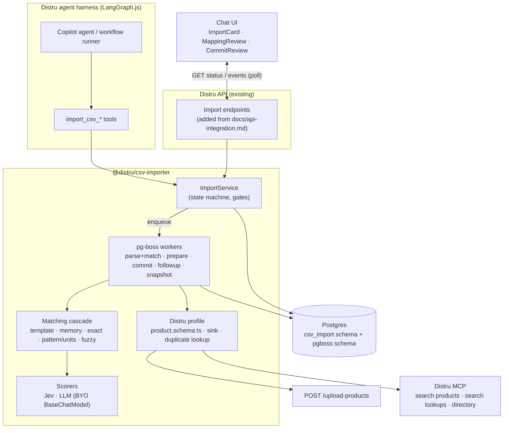
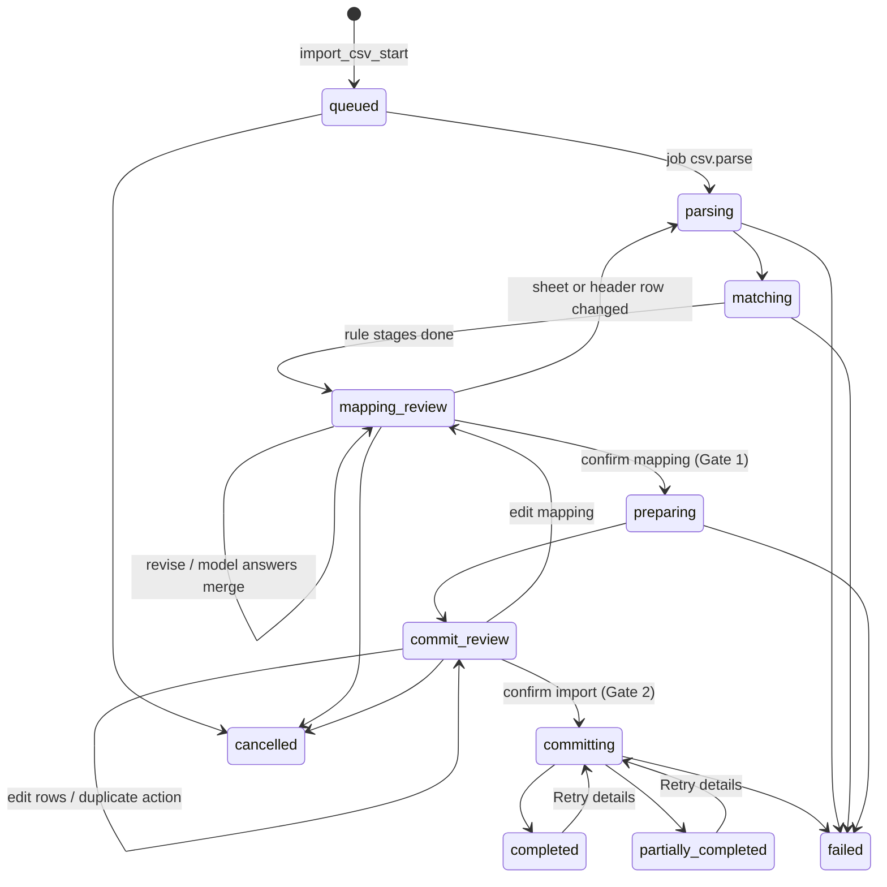
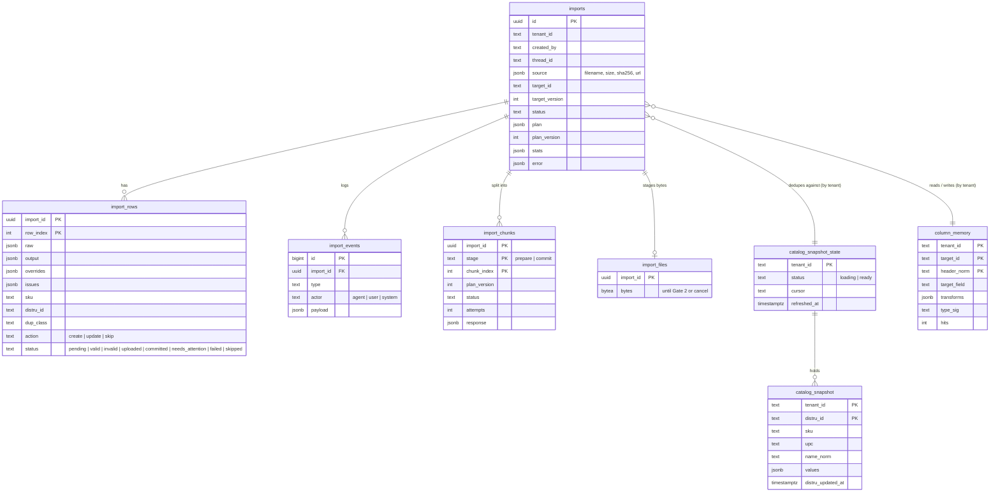

# CSV Importer — Tech Spec

## 1. Summary

A TypeScript library that turns any customer CSV/XLSX into rows matching a **target schema**, then hands them to a
**sink** (for Distru: `POST /upload-products`). It ships as LangGraph.js tools, so the Copilot chat and future
workflows run the same code ([system-design.md](system-design.md)).

- **Schema-agnostic.** The core knows nothing about products. Distru products is one profile: a schema file, a
  sink, a duplicate lookup and a reference resolver.
- **Deterministic first.** Names, synonyms, patterns, types and a cannabis unit parser resolve most columns. Jev
  scores what's left. The LLM matching stage is **off by default** (§4.1); the LLM handles free-text edits.
- **The LLM decides, code executes.** Models see headers, profiles and samples, and return a plan. Code applies it
  to every row.
- **Durable.** Every step is a pg-boss job writing to Postgres. Tool calls return immediately; the UI resumes from
  the import id.
- **Two required human gates:** confirm the mapping, confirm the import. Confidence informs, never skips a gate.
- **Distru owns I/O.** The library takes bytes or a URL; Distru owns upload, storage and the HTTP API.

Out of scope: the harness, workflow triggers, the HTTP API (we ship SQL and [api-integration.md](api-integration.md)),
file storage, entities other than products. Rationale for the calls below: [decisions.md](decisions.md).

## 2. Architecture



| Concern | Choice |
|---|---|
| Jobs, retries, resume | **pg-boss** (Postgres-native, no Redis) |
| CSV / XLSX / encoding | papaparse (in memory, ≤ 50 MB / 100k rows) · SheetJS · jschardet + iconv-lite |
| Schema / validation | Zod v4 |
| DB / migrations | `pg` + Kysely, plain SQL migration files |
| Fuzzy match | talisman (Jaro-Winkler, token-set) |
| Field scoring | Jev (TypeSafe) behind a `Scorer` port |
| LLM | BYO LangChain `BaseChatModel` |
| UI | React + TanStack Virtual, plain CSS |
| Tests | Vitest + testcontainers |

## 3. Target schema

The Distru product schema is one file, `csv-importer/src/distru/product.schema.ts`. Editing it is the only change
when Distru's template changes.

**Sources.** **H** = Distru's help article *Importing and updating products* (the template). **M** = the MCP
`distru-mutate-product` tool (types, enums, and a few fields the article doesn't list).
- `templateHeaders` holds **H fields only**, so the upload never sends a column the template might reject.
- **M**-only values are written after upload through the follow-up path (§5).
- **Field groups are atomic:** *weight* (net weight, serving size, unit) and *potency* (THC, CBD, unit). If any
  field in a group is M-only, the whole group goes through follow-up.
- Before launch: download the real template, fix header spellings, move any M field it accepts into
  `templateHeaders`. That removes its follow-up calls.

**Upload rules to respect:** `Name` is the only required column. Updates need a `Distru ID`; blank cells are ignored
and `##` clears. Vendor and brand must already exist; category, subcategory, group and strain are auto-created.
Tracking method can't change after create. Errors return as an annotated CSV.

### 3.1 Fields

| Field | Template header | Src | Type | Req / default | Synonyms / signals |
|---|---|---|---|---|---|
| `distru_id` | Distru ID | H | string | update key, verified against the tenant (§6) | distru id, product id |
| `name` | Name | H | string | **required** | item, title, product, product name |
| `sku` | SKU | H | string (unique key) | | sku, item #, code, part number |
| `upc` | UPC | H | string, keep leading zeros | | upc, barcode, gtin, ean · 8–14 digits |
| `external_name` | External Name | H | string | | display name, menu name |
| `description` | Description | H | string | | description, notes, details |
| `product_type` | — (§3.2) | — | enum | | type, product type, form |
| `category` | Product Category | H | ref, auto-created | default from `product_type` | category, class |
| `subcategory` | Subcategory | H | ref, auto-created | | subcategory |
| `group` | Group | H | ref, auto-created | | group, product group, line |
| `strain` | Strain | H | ref, auto-created | | strain, genetics, cultivar |
| `vendor` | Vendor | H | ref, **must exist** | | vendor, supplier, cultivator, grower |
| `brand` | Brand | H | ref, **must exist** | | brand, manufacturer, label |
| `owner` | Owner | H | ref → Distru user | | owner, rep, account manager |
| `unit_type` | Unit Type Name | H | ref → `UNIT_TYPE` | flower → Gram, else Each | uom, unit, sold by |
| `tracking_method` | Tracking Method | H | enum: product, batch, package | *batch* | tracking |
| `currency` | — (§3.2) | — | ISO 4217 | profile currency | currency, symbol in price cells |
| `unit_price` | Unit Price | H | money | | price, retail |
| `wholesale_price` | Wholesale Price | H | money | | wholesale, b2b price |
| `unit_cost` | Unit Cost | H | money | | cost, cogs |
| `msrp` | MSRP | H | money | | msrp, list price |
| `units_per_case` | Units per Case | H | integer | | case qty, case pack |
| `net_weight` | Net Quantity per Unit | H | number | group *weight* | weight, size, net wt (unit parser) |
| `serving_size` | Serving Size | H | number | group *weight* | serving size; also from pack notation (§4.2) |
| `net_weight_unit` | Net Quantity Unit | M | ref → `UNIT_TYPE` | group *weight* | unit parser output |
| `total_thc` | Total THC | M | number | group *potency* | thc, thca, thc % |
| `total_cbd` | Total CBD | M | number | group *potency* | cbd, cbd % |
| `cannabinoid_unit` | Cannabinoid Unit | M | enum: MG, PERCENT | group *potency* | `%` / `mg` in THC/CBD cells |
| `threshold_min` | Min Threshold | H | number | | min, reorder point, par |
| `threshold_max` | Max Threshold | H | number | | max, max stock |
| `featured` | Featured | H | bool | | featured |
| `active` | Inactive (inverted) | H | bool | `true` | active, status, discontinued (inverted) |
| `tags` | Tags | M | list of ref → `PRODUCT_TAG` | | tags, labels |

- Defaults are never silent: Gate 1 lists them under **Defaults applied**, editable.
- **Not imported in v1:** images, initial inventory/location, LeafLink product. Listed under *Ignored* with the reason.
- **SKU:** any non-empty string ≤ 64 chars. Whitespace, scientific notation or a barcode-looking value only warn.

### 3.2 Importer-only fields

| Field | Values | Use |
|---|---|---|
| `product_type` | flower, pre_roll, vape, concentrate, edible, beverage, tincture, topical, capsule, seed_clone, accessory, other | Detected from type/category columns or names (`"Live Resin Cart 1g"` → vape). Drives the `category` and `unit_type` defaults. |
| `currency` | ISO 4217, default `USD` | From a currency column or price symbol. Distru prices have no currency, so a non-default currency is a row **error**. Never converted. |
| `active` | bool | From active/inactive, yes/no, status, discontinued. Written as `Inactive = !active`. |

### 3.3 Template headers

```ts
export const productSchema = defineTarget({
  id: "distru.product",
  version: 1,
  uniqueKey: "sku",
  templateHeaders: [   // H fields only (§3)
    "Distru ID", "Name", "SKU", "UPC", "External Name", "Description",
    "Product Category", "Subcategory", "Group", "Strain", "Vendor", "Brand", "Owner",
    "Unit Type Name", "Tracking Method",
    "Unit Price", "Wholesale Price", "Unit Cost", "MSRP", "Units per Case",
    "Net Quantity per Unit", "Serving Size",
    "Min Threshold", "Max Threshold", "Featured", "Inactive",
  ],
  fields: {
    name:   f.string().required().header("Name").synonyms(["item", "title", "product", "product name"]),
    sku:    f.string().max(64).header("SKU").warnIf(["whitespace", "sci_notation", "looks_like_barcode"]),
    active: f.bool().default(true).header("Inactive").invert(),
    // … one line per field in §3.1
  },
});
```

## 4. Mapping

### 4.1 Matching cascade

Each column runs through the stages in order and stops at the first that clears its threshold. Every match records
`{ target, score, method, rationale }`.

| # | Stage | How | Accept if |
|---|---|---|---|
| 0 | Template fast path | Every normalized header is a known template header | all match → skip 1–6 |
| 1 | Tenant column memory | `(tenant, target, normalized header)` + value type check | ≥ 0.9 |
| 2 | Exact / normalized name | case, punctuation, snake/camel/plural, synonyms | 1.0 |
| 3 | Pattern, type & unit parser | regex / inferred type / §4.2 parser agree on ≥ 95% of non-blank values | ≥ 0.85 |
| 4 | Fuzzy name + type gate | Jaro-Winkler ≥ 0.88 and compatible types | ≥ 0.85 |
| 5 | **Jev** | One `Choice` per column: state = profile + samples, options = unclaimed fields + `none` | ≥ 0.75 |
| 6 | **LLM** (off by default) | Columns still unresolved, unmatched values, transforms the DSL can't infer | ≥ 0.6 |

- **Stage 6 is off by default.** In the eval with real Jev it gave no gain: precision 92.4% with it (`gpt-4o-mini` or `gpt-4o`) vs 94.8% without, recall 93.6% either way. It decided 1-2 columns per run and got none right.
  It also adds seconds before the review is final. With it off, matching ends at Jev (< 1 s) and what Jev can't
  settle becomes a Gate 1 question. Switch it on with `createImporter({ disabledStages: [] })`, or at runtime with
  `importer.setStageEnabled("llm", true)`; re-run the eval first (`EVAL_LLM=1 npm run eval`). Free-text edits
  (`revise({ instruction })`) use the LLM whenever one is configured, whatever this switch says.
- **The review opens after stages 0–4** (milliseconds). Columns waiting on models are listed under *Still matching*
  (`plan.pending`) and merge in when answered. A merge never overrides a column the user already decided. Gate 1
  waits for the merge.
- **When stage 6 is on, Jev and the LLM run in parallel** on the remaining columns; answers apply Jev first, so the result equals
  running them in sequence. The LLM returns only field + confidence; the field list sits in a cacheable system
  prompt and each column carries its five likeliest fields as a hint.
- Jev between 0.4 and 0.75, or an LLM answer under 0.6, becomes a **suggestion** the user confirms. A low-confidence
  LLM "none" doesn't ignore the column.
- **One column per target field.** On conflict the higher score wins; the loser drops to the next stage.
- **Value maps** cover every ref field: distinct values go exact → fuzzy → Jev (→ LLM when stage 6 is on) against the allowed values
  (fetched once per import, §8.3).
  - Auto-created refs (category, subcategory, group, strain): unknown values are listed as *will be created*.
  - Must-exist refs (vendor, brand, unit type, owner, tag): unknown values get **one blocking question per column**:
    add them in Distru and re-check, match each to an existing value, or leave blank. Never created.
  - A must-exist column with no known values asks "is this really Vendor?", unless the header is the field's own
    name and the values fit no other Distru list.
- **Blocking questions:** slang sizes, bare-number sizes with no unit in the header, *not a product list*, an unsure
  sheet or header row, and unknown must-exist names. An unmatched column isn't blocking; unanswered, it's ignored.
- **Derived defaults** (listed at Gate 1): `product_type` from category or name keywords; `unit_type` by product
  type; `category` from `product_type` when the file has none.
- A file in Distru's own template keeps its empty columns mapped, so *Blank cells clear* (§5) can act on them.

**Latency targets** (measured by the eval): stages 0–4 in the UI < 300 ms after parse · Jev < 1 s. With stage 6 on:
LLM < 5 s · < 20% of columns reach the LLM.

### 4.2 Unit & quantity parser

Cannabis sizes are a small vocabulary, so a regex parser handles them. It's a stage-3 signal on whole columns and a
transform that copies sizes out of names. **It never converts units**: net weight is regulated and must match the
label.

| Input | Parsed |
|---|---|
| `3.5g`, `3.5 grams`, `3,5g` | 3.5 g |
| `1/8 oz` · `1/4 oz` · `1 oz`, `2 ounces` | 0.125 · 0.25 · 1 · 2 oz |
| `1/4 lb` · `1 lb`, `5 lbs` | 0.25 · 1 · 5 lb |
| `eighth`, `8th`, `1/8` · `quarter` · `half` · `zip` | **proposed** 3.5 · 7 · 14 · 28 g, confirmed at Gate 1 |
| `qp` · `hp` · `p` | **proposed** 112 · 224 · 448 g, confirmed at Gate 1 |
| `100mg` in a THC/CBD column | `total_thc: 100`, `cannabinoid_unit: MG` |
| `22.5%` in a THC/CBD column | `total_thc: 22.5`, `cannabinoid_unit: PERCENT` |
| `1ml`, `.5ml cart` | 1 / 0.5 ml (`cart` also signals vape) |
| `5 x 0.5g`, `5pk 0.5g` | `net_weight: 2.5 g`, `serving_size: 0.5 g` |
| `5pk`, `(10ct)` with no size | no weight, `unit_type: Each`, warning to add the size |

- Each distinct slang value is a `confirm_default` question ("Read *eighth* as 3.5 g?").
- A bare-number column reads as the unit in its header (`Weight (oz)`) and is listed under Defaults applied;
  otherwise the user is asked.
- `mg` inside a product name is potency, never net weight.
- `units_per_case` is never set from pack notation (it means case packing).
- Parser units map to Distru `UNIT_TYPE` values through a value map, confirmed at Gate 1.
- **Names are never changed.** `Blue Dream 3.5g` keeps its name; the size is copied into `net_weight`.

### 4.3 Transform DSL

A closed set of pure functions. A failure is a row issue, never an exception.

| Group | Transforms |
|---|---|
| Text | `trim`, `case`, `strip_chars`, `regex_extract`, `split`, `concat` |
| Numbers | `parse_number(locale)`, `parse_money`, `parse_percent(auto/0_1/0_100)`, `fix_scientific_notation` |
| Units | `parse_quantity` (§4.2), `extract_quantity_from_name` (copies, never strips) |
| Other | `parse_bool`, `parse_date(fmt)`, `map_values(key)`, `default(value)` |

### 4.4 Mapping plan

```ts
type MappingPlan = {
  sheet?: string;
  headerRow: number;
  fields: FieldMapping[];
  ignoredColumns: { source: string; reason: string }[];
  valueMaps: Record<TargetField, Record<string, string | { create: string } | null>>;
  defaultsApplied: { target: TargetField; value: Json; reason: string }[];
  questions: Question[];
  pending?: { columns: string[]; fields: string[] };   // still waiting on Jev / LLM
};

type Question = {
  id: string;
  kind: "choose_sheet" | "choose_header_row" | "not_a_catalog" | "map_column"
      | "map_value" | "confirm_default" | "free_text";
  prompt: string;
  options?: { id: string; label: string }[];
  suggested?: string;
  answer?: string;                // set via revise(); Gate 1 is blocked while a blocking question is open
  blocking: boolean;
};

type FieldMapping = {
  target: TargetField;
  sources: string[];              // 0..n source columns
  transforms: Transform[];
  default?: Json;
  score: number;                  // 0..1
  method: "template" | "memory" | "exact" | "pattern" | "fuzzy" | "jev" | "llm" | "user";
  rationale: string;
};
```

### 4.5 Column memory

Keyed **per tenant, target and normalized header**, so a reordered or partial file reuses past decisions. Stores the
confirmed target, transforms and a value-type signature; a hit must still pass the type check. Stores only the
column's primary mapping, never derived units or sizes. Written only when Gate 1 is confirmed.

## 5. Pipeline, jobs & gates



- `partially_completed`: ≥ 1 row committed and ≥ 1 failed. `failed`: retries exhausted before anything was
  committed, or the file was rejected.
- `committing` can't be cancelled. It ends after every commit and follow-up job finishes.
- A job that fails for good marks the rows it never finished (`failed`, or `needs_attention` for follow-ups), so an
  import can't end `completed` with rows missing.

**Jobs**

| Queue | Does | Unit of work |
|---|---|---|
| `csv.parse` | Encoding, type, sheet, header row → `import_rows.raw`; then runs the cascade in the same job | one per import |
| `csv.prepare` | Transform, validate, classify duplicates | per 10k-row chunk |
| `csv.commit` | Send rows to the sink, map errors back | per 10k-row chunk |
| `csv.followup` | Per-row MCP updates (updates fallback, M-only fields) | per 500 rows, rate-limited |
| `csv.snapshot` | Load the tenant catalog into `catalog_snapshot` | one per tenant, cursor-resumable |

- **Job keys:** `singletonKey = importId:queue:chunk`. Retries, backoff and expiry from config (§5.1).
- **Checkpoints:** each chunk records its status in `import_chunks`; retries skip finished chunks.
- **Crash resume:** before a commit chunk retries, it delta-refreshes the snapshot. A SKU that appeared after the
  chunk's first attempt started is treated as created by that attempt; anything older is a new duplicate and skipped.
- **Creates and updates upload separately** (Distru runs them as separate modes). Updates carry the verified
  `Distru ID` and only changed cells.
- **Created product ids** are read back with a delta snapshot refresh after each upload (by SKU, else by name),
  because the upload returns only an error CSV.
- **Blank cells clear** (Gate 2 option, off by default): writes `##` for each blank mapped cell that has a value in
  Distru (`null` on the follow-up path). The diff shows *→ cleared*.
- **Optimistic edits:** plan and row edits carry `plan_version`; stale is rejected. An edit sent just before the
  model merge is re-applied to the merged plan.

**Follow-up path** (`distru-mutate-product`, `action: UPDATE`), for updates when `sink.uploadSupportsUpdate` is false
and for M-only values:
- A created row that still needs follow-up is uploaded with `Inactive = true` (row status `uploaded`). Its follow-up
  sets the pending field groups **and** the real `active` value in one mutation. A product is never live and
  half-finished.
- A permanent failure leaves it inactive, marks the row `needs_attention`, and offers *Retry details*.
- Retries: 429 / 5xx up to 3 times with jittered backoff; other 4xx is a row error. Each row is checkpointed
  `committed` the moment its call succeeds.
- Rate: 5 in flight, 10/s per tenant (in-process limiter; with N workers set the rate to budget ÷ N).
- **Shown up front:** Gate 2 estimates the time (*"10,000 products will be created inactive, then finished over ~17
  min"*); the card shows *Created* and *Details added* progress.

**Gates.** Nothing passes `mapping_review` or `commit_review` without an explicit `confirmMapping` /
`confirmCommit` from a person. The library never confirms on its own. The harness only picks how it's collected:
- **Copilot:** a card button, or a chat "yes" the agent relays with the user's message id. One message passes one
  gate, so a single "yes" can't approve the mapping and start the write. A message with anything beyond the
  confirmation ("yes, but ignore Notes") is an edit.
- **Workflows:** the run parks at the gate and notifies the user.

### 5.1 Configuration

One typed `ImporterConfig`, deep-merged over defaults in `createImporter({ config })`. Nothing is hard-coded elsewhere.

| Key | Default | Used for |
|---|---|---|
| `jobs.retryLimit` / `retryDelaySeconds` / `retryBackoff` | 3 / 10 / true | pg-boss retries |
| `jobs.expireInSeconds` | 900 | job timeout |
| `jobs.chunkSize` | 10000 | rows per prepare and commit chunk |
| `limits.maxFileBytes` / `maxRows` | 50 MB / 100000 | rejected up front |
| `matching.thresholds` | memory 0.9, pattern 0.85, fuzzy 0.85, jev 0.75, jevSuggest 0.4, llm 0.6 | §4.1 |
| `matching.fuzzyMin` | 0.88 | Jaro-Winkler floor |
| `scorers.timeoutMs` | jev 2000, llm 20000 | total budget per call, including one retry on error; a timeout isn't retried |
| `snapshot.pageSize` | 500 | products per catalog page |
| `snapshot.maxAgeHours` | 24 | full reload after this age |
| `snapshot.maxDeltaPages` | 20 | delta cap before a full reload (§6) |
| `sink.uploadSupportsUpdate` | false | updates via upload, or via follow-up |
| `sink.followupBatchSize` / `Concurrency` / `RatePerSecond` / `Retries` | 500 / 5 / 10 / 3 | follow-up path |
| `retention.rowsDays` | 90 | cleanup cron |
| `retention.abandonedDays` | 7 | parked imports expire |

## 6. Duplicates

Classified in `csv.prepare`, reviewed at Gate 2. Distru is the source of truth; import history only adds context.

**Catalog snapshot** (per tenant, in Postgres). MCP `search-products` has no SKU filter, so per-row checks don't
scale.
- **Full load:** `csv.snapshot` pages the catalog (`status: ANY`, 500/page) into `catalog_snapshot`, saving the
  cursor per page. No size limit; memory stays flat.
- **Reuse:** a new import runs only a **delta refresh** (`sortBy UPDATED_AT DESC` until older than `refreshed_at`),
  at prepare and before each commit chunk. Full reload when missing, older than 24 h, or the delta exceeds 20 pages.
- **Deletes** between refreshes aren't seen; an update to one fails at the sink as a row error.
- Matching is SQL joins against the snapshot. A future `find-products-by-skus` MCP tool can replace it behind the
  same port.

**Distru ID is never trusted on its own.** It counts only if found in **this tenant's** snapshot (built with the
tenant's own credentials). Otherwise it's a warning, *"Distru ID not found in your catalog"*, listed in the error
CSV, and the row falls back to SKU matching. The sink only sends IDs that came from the snapshot.

| Class | Detection (in order) | Default |
|---|---|---|
| `dup_in_file` | same SKU or Distru ID earlier in the file | skip; first row wins |
| `exists_unchanged` | matches by verified Distru ID, then SKU; all mapped values equal | skip |
| `exists_changed` | matches; some values differ | **skip**; user can switch to *update* (field diff). Tracking method is never sent. |
| `new` | no match | create |
| `no_sku` | no SKU and no Distru ID | create with a warning; *possible duplicate* if the normalized name matches |

**History:** a row whose SKU was committed by an earlier import shows *"Imported on {date}"* (`import_rows
(tenant_id, sku)`).

## 7. Persistence

`migrations/*.sql`, run by `importer.migrate()`, in the `csv_import` schema. pg-boss manages its own `pgboss` schema.
Every table has `tenant_id` with row-level security: `withTenant` runs `SET LOCAL ROLE csv_import_app` and
`app.tenant_id` in each transaction. The owner role is the system role (event tail, retention).



| Table | Purpose |
|---|---|
| `imports` | One per import: status, plan, counts. Source of truth for the UI. |
| `import_rows` | Raw, transformed output, overrides, issues, duplicate class, status. |
| `import_events` | Append-only log; the UI reads it with `afterId`. |
| `import_chunks` | Checkpoint per chunk per stage. |
| `import_files` | Staged bytes so jobs can re-read them; deleted at Gate 2 or cancel. Pass `{ url }` to avoid it. |
| `catalog_snapshot`, `_state` | The tenant's Distru catalog for duplicate checks, ID verification, subcategory and strain values. |
| `column_memory` | Confirmed column decisions per tenant. |

**Indexes:** `import_rows (import_id, status)` · `import_rows (tenant_id, sku) WHERE status = 'committed'` ·
`imports (tenant_id, status)` · unique `imports (tenant_id, target_id, source->>'sha256')` for non-terminal status (a
re-upload returns the open import) · `import_events (import_id, id)` · `catalog_snapshot (tenant_id, sku | upc |
name_norm)`.

**Retention:** `retention.*`, enforced by a pg-boss cron. Distru keeps the source file.

## 8. Interfaces

### 8.1 Library

```ts
const importer = createImporter({
  pool,                               // pg.Pool
  boss,                               // started PgBoss (Distru owns its lifecycle)
  profiles: [distruProductProfile],   // { target, sink, duplicateLookup, refResolver, currency }
  scorer,                             // Jev client
  llm,                                // LangChain BaseChatModel
  config,                             // Partial<ImporterConfig>
  disabledStages,                     // default ["llm"]: LLM matching off (§4.1); [] turns it on
});
await importer.migrate();
await importer.work();                // register workers (worker processes only)

// Every call takes { tenantId, actor } first (omitted below).
const { importId } = await importer.start({ input: { bytes } | { url }, filename, targetId, threadId });
await importer.get(importId);                         // status, counts, plan, questions, confidence
await importer.events(importId, { afterId });
await importer.listRows(importId, { status, cursor, limit });
await importer.revise(importId, { planVersion, patch } | { planVersion, instruction });
await importer.editRows(importId, { planVersion, edits });
await importer.setRowActions(importId, { planVersion, existingAction: "skip" | "update", rowOverrides });
await importer.confirmMapping(importId, { planVersion });   // Gate 1
await importer.confirmCommit(importId, { planVersion });    // Gate 2
await importer.cancel(importId);
await importer.retryFollowups(importId);
await importer.errorCsv(importId);                    // ReadableStream
```

`ImportEvent.type`: `status_changed`, `column_resolved`, `question_added`, `question_answered`, `plan_revised`,
`chunk_progress`, `row_edited`, `gate_confirmed`, `error`. Payloads are typed per type.

### 8.2 Agent tools (`@distru/csv-importer/langgraph`)

| Tool | Purpose | Returns |
|---|---|---|
| `import_csv_start` | Queue an import from an attachment id | `importId`, status |
| `import_csv_get` | Status, counts, open questions, confidence | compact summary |
| `import_csv_revise` | Natural-language or structured mapping change | diff + new counts |
| `import_csv_confirm_mapping` | Pass Gate 1, with the user's confirming message id | status |
| `import_csv_confirm_commit` | Pass Gate 2, with the user's confirming message id | status |
| `import_csv_cancel` | Cancel | status |

- `tenantId` and `actor` come from the run config, never from model arguments.
- A resolver Distru passes to `createImporterTools()` turns an attachment id into `{ bytes } | { url }`.
- Results stay under 1k tokens and never include rows. `awaitGate(importId)` wraps `interrupt()` for workflows.
- LLM calls use `withStructuredOutput`: `functionCalling` for OpenAI/OpenRouter, `jsonSchema` for Anthropic
  (`LLM_STRUCTURED_METHOD` overrides).

### 8.3 Distru profile ports

| Port | Distru implementation |
|---|---|
| `RefResolver` | MCP `distru-search-lookups` for category, group, tag, unit type. Subcategory and strain from distinct snapshot names. Vendors and brands from company search; owners from users. Once per import. |
| `DuplicateLookup` | `catalog_snapshot` via MCP `search-products` (§6) |
| `Sink` | Template CSV → `POST /upload-products`, parse the error CSV; `csv.followup` for updates and M-only fields |

The upload and MCP contracts are assumptions, isolated in `csv-importer/src/distru/profile.ts` and listed in
[api-integration.md](api-integration.md), along with one API endpoint per library method.

## 9. Edge cases

| Case | Behavior |
|---|---|
| 0 bytes, headers only, blank rows only | `failed`: "File has no data rows" |
| Blank lines, trailing totals rows | dropped, counted in `stats.skippedRows` |
| `.csv` that is really XLSX / HTML / JSON | magic-byte sniff; parse by real type or fail "Not a spreadsheet" |
| Not a product catalog (< 2 fields matched, or no `name`) | Gate 1 question "This doesn't look like a product list"; nothing written |
| Header not on row 1, two header rows | score the first 20 rows; ask when unsure |
| Multiple sheets | use the only one with data, else ask |
| Truncated / password-protected XLSX, > 5% encoding errors | `failed` with a specific message, no partial import |
| Ragged rows | padded or trimmed, issue per row |
| Over size or row limits | rejected up front |
| Worker dies | pg-boss retry; chunk checkpoints skip finished work |
| Crash mid-commit | snapshot re-check before retry; never creates twice |
| Reload / dropped connection | UI calls `get` + `events` with the same `importId` |
| Abandoned at a gate | parked; expires after `retention.abandonedDays` |
| Catalog changes between Gate 2 and commit | delta refresh per chunk; new duplicates skipped and reported |
| UI and agent edit at once | `plan_version` conflict; loser reloads |
| Jev / LLM fails or times out | column becomes *needs you*; never dead-ends |
| Same file re-uploaded while open | the open import is returned |
| `$1,234.50` vs `1.234,50`; `22.5%` vs `0.225` | locale-aware `parse_number` / `parse_percent` |
| Scientific-notation SKUs, lost leading zeros | warning |
| One column → many fields; many → one | `FieldMapping.sources` + transforms |
| Non-default currency (`€12`) | row error; never converted |
| Prompt injection in cells | cells are data; models return plans constrained to the schema and DSL, reviewed at Gate 1 |

## 10. UX

The user drops a file in Copilot. An inline **ImportCard** shows file stats, then mapping rows as they resolve, each
with a confidence dot and the method that matched.

- **Gate 1 — mapping:** sections **Needs you**, **Mapped**, **Still matching**, **Defaults applied**, **Ignored**,
  plus a value-map editor. *Confirm mapping*.
- **Gate 2 — import:** create / update / skip / invalid counts, update diffs, a skip/update toggle for existing SKUs,
  *Blank cells clear*, the follow-up estimate. *Import N products*.
- **Result:** *Created* and *Details added* progress, rows needing attention with *Retry details*, error CSV
  download. After a reload the card rebuilds from `importId`.

## 11. Repo layout & build order

One package, `@distru/csv-importer`, with a subpath export per module.

| Path | Import as | Contents |
|---|---|---|
| `csv-importer/src/core` | `@distru/csv-importer/core` | parse, profile, unit parser, DSL, cascade order/thresholds/conflict rule, plan, validate, dedupe, template output, chunking, `ImportService`, ports |
| `csv-importer/src/scorers` | `…/scorers` | stage matchers 0–6, value-map matchers, model gateway, mock + real Jev/LLM |
| `csv-importer/src/pg` | `…/pg` | store (Kysely, RLS via `withTenant`) |
| `csv-importer/migrations` | | `*.sql`, run by `importer.migrate()` |
| `csv-importer/src/workers` | `…/workers` | `createImporter`, pg-boss queues and jobs |
| `csv-importer/src/langgraph` | `…/langgraph` | `import_csv_*` tools, `awaitGate` |
| `csv-importer/src/distru` | `…/distru` | `product.schema.ts`, Distru profile, `MockDistru` |
| `csv-importer/src/ui` | `…/ui`, `…/ui/styles.css` | React components |
| `demo/` | | dev-only chat + mock Distru that runs the library |
| `fixtures/`, `tests/`, `scripts/` | | 7 messy catalogs + expected plans; integration tests; eval, fixture generator, packaging |

Build order: core → pg → workers → distru profile + mock sink → scorers → langgraph tools → ui.

## 12. Verification

- **Unit:** every DSL transform, every §4.2 parser row, each matcher stage, parser fixtures.
- **Integration (testcontainers):** full lifecycle through both gates; one message passes one gate; kill a worker
  mid-commit and resume with no duplicates; a foreign Distru ID is never sent; delta refresh sees a product created
  after Gate 2; follow-up rate limit, 429 retry, 4xx → `needs_attention`, resume skips committed rows; M-only values
  only via follow-up; created rows inactive until follow-up succeeds; weight and potency groups never split;
  *Blank cells clear* writes `##` only where Distru has a value; snapshot cursor resume and delta overflow; stale
  `plan_version`; column memory on a reordered file; 25k rows → 3 chunks.
- **Matching eval (`npm run eval`):** per-fixture precision and recall, share resolved per stage, latency vs §4.1.
  Runs without the LLM stage, like production; `EVAL_LLM=1` includes it for comparison.
- **E2E (Playwright, demo page):** drop a fixture, pass both gates, reload mid-commit, download the error CSV.
